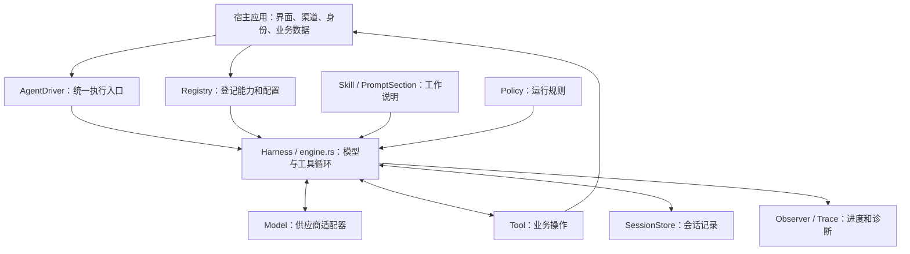
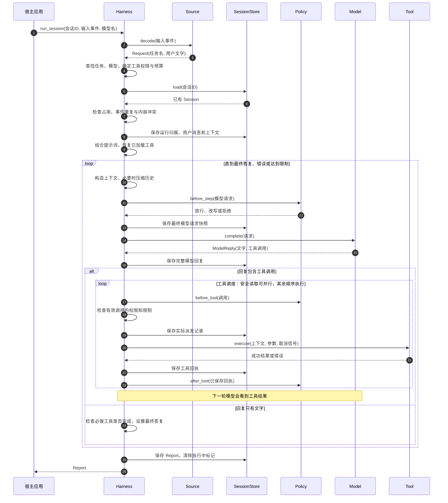
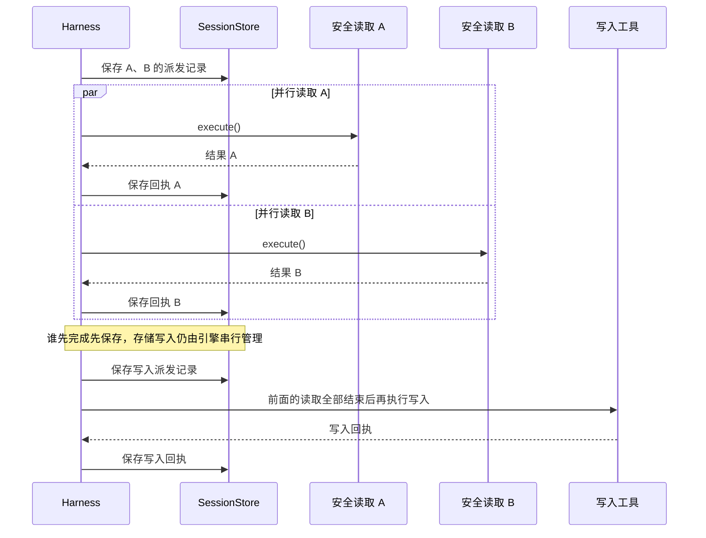
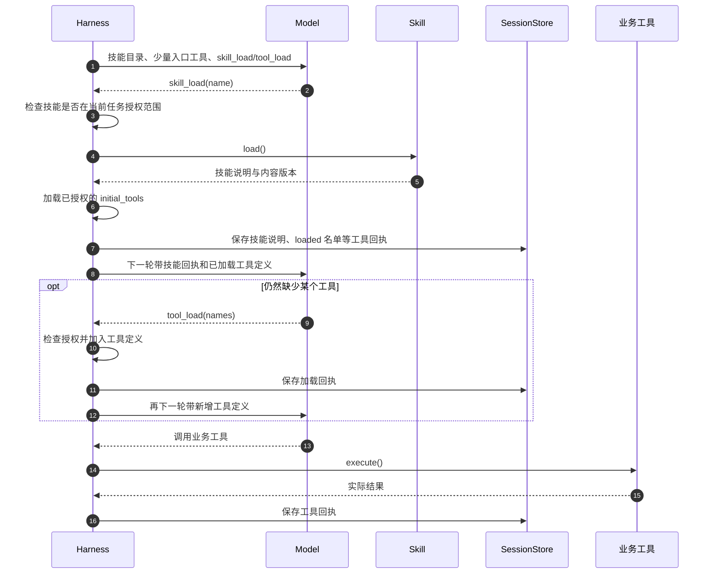
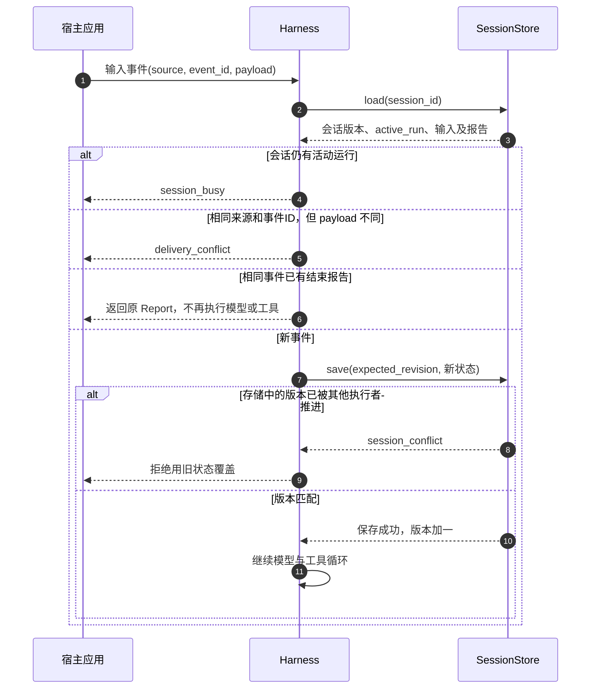
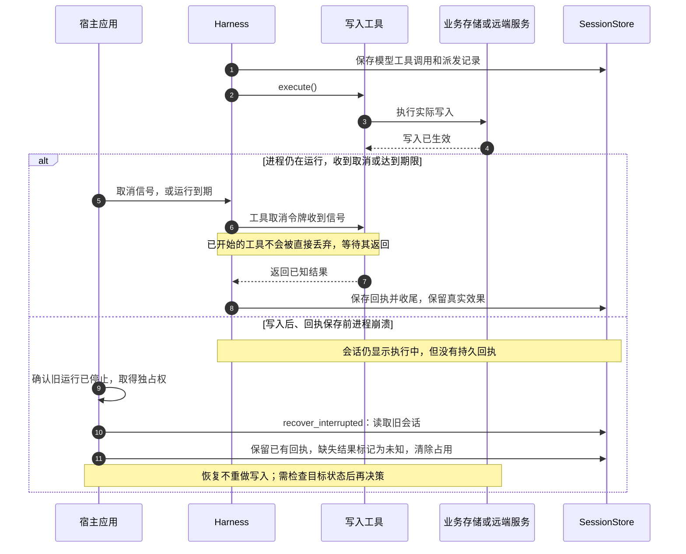
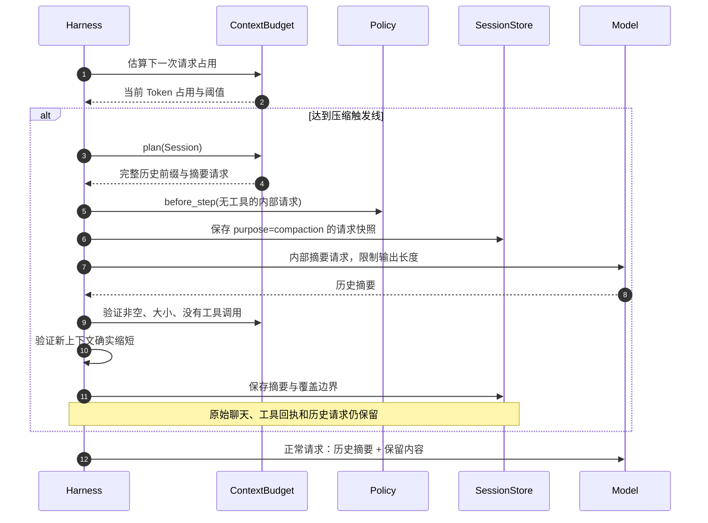

# Harness³ 中文导读：从一条消息到可靠的执行结果

[项目首页](README.zh-CN.md) · [运行契约](docs/runtime.md) · [可运行示例](examples/quickstart.rs)

Harness³ 面向 Agent 集群提供可组合的执行内核；本文中的 `Harness` 指 Rust 执行器类型。

这份导读对应本目录的实际 Rust 源码。示例中的“查找联系人”“保存资料”用于解释协作关系，具体业务工具由外部应用提供。

**Harness 是 Agent 的执行内核：把用户输入交给模型，检查并执行模型要求的工具，把工具结果交回模型，同时记录每一步，直到得到答复或停止。**

模型负责选择下一步；工具负责真正读写数据；Harness 负责执行顺序、权限边界、会话记录和中断收尾。它不内置领域规则、通信渠道或数据库实现，这些能力由使用它的应用接进来。下文把这个应用叫作“宿主”。

## 1. 先认识这些名字

| 代码名称 | 通俗解释 | 本例中的含义 |
| --- | --- | --- |
| `InboundEvent` | 收到的一封信：来源、编号、内容 | 桌面发来的“帮我记住小王在 A 公司” |
| `Source` | 拆信的人，把渠道消息翻译成统一请求 | 从 JSON 取文字，选择任务配置 |
| `AgentProfile` | 当前助手的工作说明和权限清单 | 指令、可用工具、可用技能、可选的必做工具 |
| `Registry` | 启动时准备好的能力名册 | 登记模型、工具、技能、策略等 |
| `Harness` | 执行协调者 | 组织模型和工具来回工作 |
| `Model` | 对模型供应商的统一接口 | 返回文字或工具调用请求 |
| `ToolSpec` / `Tool` | 工具说明书 / 真正干活的代码 | “保存资料”的参数格式 / 实际数据库操作 |
| `Skill` | 工作方法说明书 | 先查重、再保存、如何处理不确定信息 |
| `Session` | 一段连续会话的工作档案 | 用户消息、模型回复、工具回执、请求快照 |
| `SessionStore` | 保存工作档案的接口 | 内存实现，或宿主的 SQLite 实现 |
| `Policy` | 执行前后可介入的规则 | 拒绝调用、改写参数、执行后的检查 |
| `Report` | 一次运行的结果报告 | 最终文字、错误、工具结果、Token 用量 |

三个时间单位不要混淆：

- **Session（会话）**：可以持续多天，包含多条用户消息。
- **Run（一次运行）**：处理一条输入事件，从接收到收尾。
- **Round（模型轮次）**：一次普通模型请求及随后的工具处理；一个 Run 可以有多个 Round。内部历史摘要请求另行记录。

## 2. 总体结构



可以把它比作一个工作小组：模型提出行动建议，工具实施行动，Harness 安排顺序并保存回执。技能给模型工作方法，策略给执行过程施加规则。

## 3. 时序图一：一次正常请求如何完成

读图方法：从上往下是时间推进，横向箭头是调用，虚线箭头是返回；`loop` 表示重复，`alt` 表示不同分支。为便于阅读，图中“保存”省略了底层版本检查，后面单独解释。



对应入口：[engine.rs 的 `run_session`](src/engine.rs)。上图展示放行的正常路径；权限拒绝会生成错误回执，不会进入实际工具执行。

用一个具体例子理解：

1. 用户说：“帮我记住小王在 A 公司。”
2. 模型可能先请求查找小王，Harness 执行查询工具并记录查询结果。
3. 下一轮模型读到结果，确定人物 ID，再请求保存资料。
4. 保存工具完成数据库操作，返回结果，Harness 保存回执。
5. 下一轮模型根据回执生成答复，这次没有工具调用，运行进入收尾。

第 2～4 步由模型和工具结果推动，不是在 Harness 中写死的业务流程。若重名导致无法判断，模型也可以直接问用户“你指的是哪位小王？”，本次 Run 正常结束；用户下一条消息用同一 Session 开始新的 Run，历史仍然可见。

**重要细节：**

- 模型一次可以返回多个工具调用。连续的、已授权且明确声明 `parallel_safe()` 的只读工具最多 4 个一批并行；其他调用维持顺序。`mutates=false` 本身不足以证明可并行。
- 同时带文字和工具调用的回复属于中间步骤；只有不带工具调用的有效文字回复才进入最终答复分支。
- 工具执行错误通常被包装成模型可读的工具结果。模型有机会修正参数或换方法，错误并不一律立即终止 Run。
- 若配置 `required_tool`，最终结束前会检查本次报告里是否出现该工具的 `changed = true` 回执。它不是对所有业务目标的通用成功证明。
- `run()` 每次建立新的临时内存会话；持续对话要用 `run_session()` 或 `AgentDriver::run_turn()`。

### 同批工具如何并行



`parallel_safe()` 默认是 `false`，工具作者确认同工具多次调用及不同工具调用之间可以安全重叠后才开启。当前已开启人物查询、外部读取和技能参考资源读取；浏览器、文件提取及写入工具保持顺序。外部读取自己的预算预留和缓存写入仍经过宿主的事务与共享存储锁，网络等待可以重叠。

写入、未声明安全的工具、`skill_load` / `tool_load` 都是顺序边界：先等前面的并行调用结束，再执行它们，然后才处理后面的调用。模型需要前一步结果才能决定的操作，应放在下一轮请求。注册了 `Policy` 时整个工具批次保持顺序，因为策略可能根据前一个回执改写或阻止后续调用。

每个已完成结果按调用 ID 对应原请求，完成顺序不必等于模型列出的顺序。一次读取返回错误，不妨碍同批其他读取产生回执。若发生取消、超时、检查点保存失败或 Observer 失败，引擎会收尾已启动调用，保留已知结果，然后停止；不会为加速而丢弃正在执行的工具。永久存储故障仍可能使最终回执无法持久化，报告不能把它当成功。

并行使用当前任务内的异步等待，不另起独立任务，因而保留宿主任务局部上下文。这里主要加速网络等等待；同一个 SQLite 锁下的读操作或同步 CPU 计算不会因此变成多核并行。当前每批最多 4 个，等整批结束再开始下一批。

## 4. 时序图二：技能和工具为什么要按需加载

有很多工具时，把所有参数说明都放进每次模型请求会占用大量上下文。渐进加载让模型先看技能目录，再加载相关说明和少量工具。



对应代码：[engine.rs](src/engine.rs) 的 `progressive-tools`、`skill_load`、`tool_load` 分支，以及 [skills.rs](src/skills.rs)。

这里有三层不同的含义：

| 层次 | 含义 | 是否代表这一步能直接调用 |
| --- | --- | --- |
| 已注册 | 程序里存在这个工具实现 | 不一定 |
| 已授权 | 当前 `AgentProfile.tools` 允许使用 | 渐进模式下还要先加载 |
| 已加载、已随本次请求提供 | 当前模型请求中有工具定义 | 仍要通过策略、限制和工具自身参数校验 |

本轮模型没看到的工具，不能在同一批调用里“边加载边立即执行”。执行时检查的是本次模型请求实际提供的 `admitted_tools`，新增定义到下一轮才可用。

`skill_load` 返回的是说明文字，不执行说明里的脚本。`FileBundle` 把技能说明、资源目录和相关工具名组织在一起；需要具体文件时，由资源读取工具按声明的 ID 读取。磁盘资源读取有路径检查、符号链接越界检查和 64 KiB 文件大小限制。

`tool_load({})` 返回当前任务的授权工具目录；`tool_load({"names":[...]})` 一次最多加载 8 个工具定义。`FileBundle` 的 `initial_tools` 最多声明 8 个工具，有参考资源时还会添加对应资源读取工具，最终仍受任务授权过滤。

同一会话后续输入会从成功的加载回执恢复工具名，再匹配当前仍授权的工具定义，避免每条消息从零加载。技能正文作为历史工具结果保留，历史压缩后可能进入摘要。`loaded_skills` 这个集合只防止当前 Run 重复读取，并非永久“已加载”标记。

## 5. 时序图三：如何防止重复保存与并发覆盖



对应代码：[engine.rs](src/engine.rs) 的输入准入，以及 [session.rs](src/session.rs) 的 `SessionStore`、`checkpoint`、`seal`、`validate_append`。

**防重复和防并发解决的是两个问题。**

- 防重复：在同一会话内，用 `(source, event_id)` 识别一次输入。已结束的输入再次送来，返回原来的报告，包括原来的失败报告。确实要重新尝试，需要新的事件 ID。
- 防并发：保存时声明“我是基于版本 7 修改的”。存储若已变成版本 8，就拒绝覆盖。这个检查必须在存储层原子完成，不能只在内存里先检查再写入。

`Session` 为什么同时保存很多东西：

| 字段 | 记录什么 | 为什么需要 |
| --- | --- | --- |
| `turns` | 用户、上下文、助手、工具结果 | 下一轮能够继续对话 |
| `requests` | 模型名、提示词、工具定义、历史范围、压缩状态等 | 重建当时实际提交的 Harness 层请求 |
| `dispatches` | 模型原始调用、策略修改后的调用、拒绝原因 | 区分“模型想做什么”和“程序实际准备做什么” |
| `events` | 不可改写的检查点增量 | 回看某个历史边界、验证旧历史没有被修改 |
| `inputs` / `completed` | 输入指纹、已经结束的报告 | 防止同一输入被重复执行或偷偷换内容 |
| `active_run` / `active_delivery` | 当前运行与输入的归属 | 识别占用和未正常结束的运行 |
| `revision` / `format_version` | 保存次数推进的版本 / 数据格式版本 | 防并发覆盖 / 拒绝误读未来格式 |
| `compaction` | 摘要及摘要覆盖的历史边界 | 缩短后续送给模型的上下文 |

“请求可重建”不等于重跑模型一定得到相同答案，也不等于还原供应商 HTTP 请求的每一个字节；供应商协议翻译由模型适配器负责。

`replay(cursor)` 只还原会话数据，不调用模型、工具、Observer 或 Transport。`fork(cursor)` 只允许在已结束的边界建立分支，保留已有回执；宿主需要为分支选择新会话 ID。它们都不会撤销现实世界已经发生的操作。

## 6. 时序图四：中途停止或崩溃时怎么办

正常取消与进程崩溃不一样。正常取消时程序还能收尾；崩溃时可能根本来不及保存最后结果。



对应代码：[engine.rs](src/engine.rs) 的工具取消与收尾，以及 [session.rs](src/session.rs) 的 `settle_pending`、`recover_interrupted`。

为什么不简单“失败就重试”？因为请求失败可能只是响应丢失，实际操作已经成功。如果是发消息或写资料，盲目重试就可能重复发送或重复创建。

因此必须区分：

- 有成功回执：保留已完成事实，即使后续模型失败。
- 有失败回执：把实际错误记录给下一轮。
- 没有持久回执：标记结果未知，不凭空宣称成功，也不把 `changed = false` 误当成“外部绝对没变”。

Harness 无法让任意远程服务写入和本地检查点成为同一个事务。严格防止重复副作用还需要工具或远端提供幂等键、事务等能力。这里的“幂等”就是同一操作重复提交，最终不会多做一份。

取消机制也有明确限制：

- 模型请求被取消或超时时，可中断等待；已通过 `LiveOutput` 汇报的文字前缀会在正常收尾时作为助手消息保存，但本次运行仍然失败。
- `LiveOutput` 不逐字写数据库。进程在收尾前崩溃，内存中的未保存片段仍可能丢失；只有思考片段而没有文字时，也不会单独生成助手消息。
- 已开始的业务工具使用协作式取消，并等待工具返回。工具不响应取消，就可能超过设定超时时间；超时不是安全杀死任意代码的硬开关。

## 7. 时序图五：历史太长时怎样压缩

模型一次能接收的信息有限。`context.rs` 负责估算占用并选择完整历史片段，`engine.rs` 负责向同一个已注册模型请求摘要、检查结果并保存。



对应代码：[context.rs](src/context.rs) 与 [session.rs](src/session.rs) 的 `project`。

默认配置是 128,000 Token 窗口，80% 触发，尝试压到 60%，为输出预留 8,192 Token，摘要最多 8,192 Token，保留最近两个完整交换单元。模型适配器或宿主可以覆盖这些值。

这里的“交换单元”不是固定的一问一答：一条助手工具调用和对应的所有结果也构成一个完整边界，所以长工具循环中也可以压缩。不能把一个调用与它的结果拆开，只保留其中一半。

压缩还有几个重要约束：

1. 当前用户请求保留原文，不能只靠模型生成的摘要替代。
2. 摘要是历史资料，不是新指令或新增授权；内部摘要不会作为正常聊天文字向用户发布，适配器必须遵守 `LiveOutput::is_internal()`。
3. 摘要无效、失败或取消，不替换原摘要；压缩无进展报 `compaction_no_progress`。无可压缩内容且超出输入上限报 `context_limit`，不会静默删掉用户请求。
4. 即使没降到 60%，只要保留约束使其不能继续压缩且仍能装入输入上限，运行也可以继续。
5. 原始会话仍在增长。这里压缩的是“下次发给模型的阅读材料”，不是删除档案或缩小数据库。

占用估算优先使用匹配当前模型和压缩状态的历史回复用量，以其 `input + output` 为基线，加上新增内容的估算量；没有匹配用量时按序列化 UTF-8 字节数除以 3 估算。这是容量判断，不是精确计费。`Report.usage` 则累加本次运行已报告的模型用量，也包括内部摘要请求，两者用途不同。

## 8. 逐个源码文件说明

### `lib.rs`：公共词汇和接口

[打开源码](src/lib.rs)。先看它，可以知道其他文件传来传去的是什么。

- 输入类：`InboundEvent`、`Request`、`Context`。`Context` 带运行 ID、来源、事件 ID、原始文字和宿主元数据，交给工具判断本次操作的上下文。
- 模型类：`ModelInput`、`ModelReply`、`Model`、`LiveOutput`。`ModelReply.calls` 是模型希望执行的工具列表；`continuation` 留给供应商适配器保存专有续接状态。
- 工具类：`ToolSpec`、`Call`、`ToolOutput`、`Observation`、`Tool`。`Observation` 把一次调用和结果配成一对，`Call.id` 用来关联两者。
- 会话内容：`Turn::User`、`Context`、`Assistant`、`Tools`，分别表示历史中四种记录。
- 运行配置和结果：`AgentProfile`、`Limits`、`Report`；事件订阅接口是 `Observer`。

`ModelInput.text` 在历史投影中是第一条用户类型消息，其余记录在 `turns`，所以不要把它理解成永远等于“刚收到的那句话”。压缩之后它也可能是历史摘要包装。

`Result<Report>` 还有两层成功语义：外层 `Err` 可以表示请求未能正常进入执行，例如会话忙；外层 `Ok(report)` 也可能携带 `report.error`，表示已经执行并形成报告，但目标没有完整完成。

### `engine.rs`：主流程

[打开源码](src/engine.rs)。这是整套代码最重要的阅读入口。

`Harness` 持有注册表、运行限制、诊断缓冲和可选上下文预算。`run_session` 依次处理准入、提示词、模型循环、工具执行、收尾。`parallel_allowed` 判断并行资格；`execute_call` 统一执行工具并处理期限与取消；`run` 是一次性会话的便捷包装；`remaining` 计算剩余时间；`loaded_tool_names` 从回执恢复已加载工具。

默认限制是 256 个普通模型轮次、1,024 次工具调用、3,600 秒运行时间。它们是限制，不是建议每次都用完；已开始的工具仍遵守前述协作取消边界。

有两种特殊的一次性生成修复：模型适配器返回 `malformed_tool_json`，或模型返回空白文字且没有工具调用。它们各最多一次，消耗原有轮次和时间预算，不重放已经完成的工具。普通网络或供应商错误没有通用自动重试。

对于连续相同的参数/工具契约错误，或同一 Run 内重复加载已加载技能，代码跟踪同一工具、参数、结果是否连续出现三次，并在批次处理后判断是否以 `tool_limit` 停止。它不是对所有失败一概重试三次。

### `registry.rs`：组装能力

[打开源码](src/registry.rs)。保存名称到实现的映射，比如模型名到 `Model`、工具名到 `Tool`。名称重复时拒绝注册，避免无意替换原能力。

`provide<T>` / `service<T>` 提供带类型检查的共享能力；例如 `progressive-tools` 服务的值是入口工具名列表。

`register` 先克隆注册表，再在副本上登记；全部成功才替换原表，避免“装了一半”。这里事务化的是注册表变化，不会回滚注册函数擅自进行的外部网络请求或共享对象内部修改，因此安装函数应只登记能力。

这里的能力安装使用 `Registry::register` 和宿主安装函数，不需要另外实现一个 `Plugin` trait。

### `session.rs`：会话档案与恢复

[打开源码](src/session.rs)。实现会话结构、内存存储、历史重建、分支、压缩投影和故障收尾。

`checkpoint` 将新事实封成增量事件，再按期望版本保存。`seal` / `validate_append` 阻止改写已有历史；`request_input` 重建当时模型请求；`recover_interrupted` 处理已经失去执行者的运行。

本文件定义存储规则但不绑定数据库。`MemorySessionStore` 只在内存里保存；真正持久化需要宿主提供 `SessionStore`。数据格式版本与业务 App 版本是不同概念，遇到不支持的新会话格式会拒绝读取。

### `context.rs`：上下文预算与摘要方案

[打开源码](src/context.rs)。`ContextBudget` 存预算；`used_tokens` 算占用；`plan` 找可以摘要的完整历史前缀；`proposed` 验证摘要。它负责计算和规划，真正模型调用仍在 `engine.rs`。

### `skills.rs`：说明书与参考资源

[打开源码](src/skills.rs)。`Manifest` 是能力包清单，`SkillInfo` 是目录信息，`LoadedSkill` 是实际说明及内容哈希。`FileBundle` 支持磁盘文件和编译进程序的文本。

磁盘技能实际加载时重新读取正文，计算 SHA-256 作为内容版本；这不是签名校验，也不表示文件可信。这里只读取说明和声明的资源，不运行脚本、不动态加载本地二进制插件。

### `prompt.rs` 与 `interaction.md`：组合模型工作要求

[prompt.rs](src/prompt.rs) 定义 `PromptSection`。引擎按 `(order, name)` 排序，将各段 `render` 的结果追加到任务指令里。

[interaction.md](src/interaction.md) 是 `InteractionPrinciples` 引入的通用指导：跟随用户当前目标、按证据选择工具、错误后调整方法、保留已完成结果、区分成功和不确定性。宿主需显式注册这段提示词，它不是自动生效的全局规则。

提示词主要影响模型行为，不能替代工具端校验或执行权限检查。

### `policy.rs`：三个执行检查点

[打开源码](src/policy.rs)。按注册顺序调用。

| 接口 | 发生时机 | 可以做什么 | 关键边界 |
| --- | --- | --- | --- |
| `before_step` | 模型请求发出之前 | 修改或拒绝请求 | 不得增加未授权的工具定义 |
| `before_tool` | 工具实际执行之前 | 修改工具名、参数，或拒绝 | 调用 ID 必须保留，修改后仍要检查权限 |
| `after_tool` | 工具回执已经保存之后 | 检查结果，阻止继续执行 | 不能撤销已经发生的效果或改写回执 |

它是可信宿主代码的介入点，不是一个现成的用户授权界面。

### `trace.rs`：诊断记录

[打开源码](src/trace.rs)。`Trace` 在内存保留最近 10,000 条诊断事件；`Harness::trace_events()` 可以取出。宿主可注册 `TraceSink` 转存或转发，每次记录最多等待 2 秒，失败不使业务回执失效。

不要混淆三个“记录”机制：

| 机制 | 目的 | 故障影响 |
| --- | --- | --- |
| `SessionStore` / `SessionEvent` | 执行事实与恢复依据 | 保存失败必须作为运行问题处理 |
| `Observer` / `Event` | 顺序通知进度或接入宿主行为 | Observer 返回错误可使执行报错 |
| `Trace` / `TraceSink` | 调试模型、工具、策略和压缩 | 尽力记录，Sink 错误被忽略 |

`emit` 会先写 Trace 再通知 Observer；还有只写 Trace 的细节事件。这里没有内置 Langfuse SDK，也不自动脱敏所有载荷，适配器和宿主需要处理凭据与展示安全。

### `driver.rs`：给宿主的统一执行入口

[打开源码](src/driver.rs)。定义 `AgentDriver::run_turn`，`Harness` 的实现直接委托给 `run_session`。宿主可面向这个接口调用，未来更换执行循环时仍使用同一组入参和报告。

### `transport.rs`：显式发送消息

[打开源码](src/transport.rs)。`Outbound` 是待发消息，`Receipt` 是外部发送回执，`Transport::send` 是发送接口。`Registry::deliver` 验证基本字段并调用已登记适配器。

模型回复完成不会自动触发发送。宿主决定是否发送、给谁发送，并管理发送台账、凭据与不确定结果。生成答复和对外投递是两项独立操作。

### `work.rs`：后台工作领取接口

[打开源码](src/work.rs)。只有 `WorkLease`、`WorkStore::claim`、`settle`：领取任务租约，处理后结算。

租约类似临时领取凭证，包含工作 ID、代次、令牌和载荷。这里没有定时器、后台轮询循环或实际存储实现；调度和执行由宿主负责，`engine.rs` 也不会自动调用它。

## 9. 其他文件与验证

| 文件 | 用途 |
| --- | --- |
| [Cargo.toml](Cargo.toml) | Rust 包信息和依赖；模型 SDK、SQLite 都不在本包的直接依赖中。版本号独立声明，可复制目录后单独构建 |
| [README.md](README.md) | 英文能力说明、使用入口和运行契约 |
| [LICENSE](LICENSE) | MIT 许可证 |

本独立仓库可以执行：

```sh
cargo check --locked
cargo doc --locked --no-deps
```

确定性行为 case 由原应用仓库的 CLI 维护，未包含在本仓库中。它们使用模型替身验证执行协议；上述构建与文档检查不替代行为验证，也不证明真实模型每次都能理解用户意图。

## 10. 宿主应用怎样接入

宿主实现自己的模型适配、存储和工具，通过公开接口组装运行时；Harness 不依赖宿主目录或源码。

| 接口或步骤 | 宿主职责 |
| --- | --- |
| `Registry` | 注册模型、工具、提示词、技能和观察者 |
| `Source` | 将外部输入转换成统一 `Request` |
| `SessionStore` | 持久保存 checkpoint，实现 revision 校验并保证会话独占 |
| `Model` | 把统一请求转换成供应商协议，报告流式输出与用量 |
| `AgentDriver` | 运行一轮执行并处理报告；需要自定义循环时实现此接口 |
| `Transport` | 在宿主授权下发送结果，记录确定或未知的外部回执 |

使用渐进工具加载时，宿主注册 `progressive-tools` 入口列表，模型通过 `tool_load` 与 `skill_load` 按需加载获准能力。具体业务的数据校验、事务和外部授权在宿主工具中完成。

## 11. 为什么代码这样设计

以下是从代码结构和约束能看出的设计取舍。

**把工作方法与执行保障分开。** 模型决定下一步，让不同业务复用同一循环；程序保障权限、参数校验入口、记录、取消和预算。这保留模型的灵活性，但也要求宿主和工具明确判断哪些动作被允许，不能单靠提示词约束。

**每个关键步骤先后留证据。** 调模型前保存请求，执行工具前保存派发，执行后保存回执，最后保存报告。它使故障定位和继续对话有据可查，代价是更多检查点写入。`session.rs` 明确注明当前封存和校验每次都遍历历史，长会话会增加开销，未来可在确有需要时换成增量事件存储。

**先登记能力，再由小内核调度。** `Model`、`Tool`、`SessionStore` 这些接口把供应商和业务数据与循环分开。换模型供应商、换存储、加业务工具不必把对应代码都塞进 `engine.rs`；实际注册错误也能在组装阶段暴露。

**记录已发生的事实，不自动重做不确定的写入。** 这避免把网络错误误判为业务没发生，是可靠 Agent 比普通“问一次模型”的脚本复杂得多的主要原因。

**对大上下文按需加载、只改变阅读投影。** 工具定义和技能正文按需加入，旧历史可以摘要，但原档案保留。这减少模型每次需要读的信息，同时保留历史证据；代价是多一些加载或摘要轮次，以及摘要可能损失细节。

**诊断与业务记录分开。** 调试服务故障不应改变业务事实，所以 TraceSink 尽力而为；会话存储则是恢复依据，不能用 Trace 替代。

## 12. 不熟悉 Rust 时怎样读

无需先学完 Rust。先识别这些常见表达，就能跟住流程：

| 写法 | 阅读时可理解成 |
| --- | --- |
| `struct` | 一组有名字的数据字段 |
| `enum` | 几种互斥情况，例如用户消息或工具结果 |
| `trait` | 一份接口约定：实现者必须提供哪些能力 |
| `impl` | 给某种类型编写实际行为 |
| `Arc<dyn Tool>` | 可共享的工具对象，实际是哪种工具在注册时确定 |
| `async fn` / `.await` | 可能需要等待，等结果到达再往下走；不代表自动并行 |
| `Result<T>` / `?` | 可能成功或失败；`?` 遇错提前返回当前函数或异步块 |
| `Option<T>` | 有值或没有值，例如没有设置必做工具 |
| `match` / `if let` | 根据结果类型选择分支 |
| `tokio::select!` | 同时等几件事，例如模型结果和取消信号，按先满足的分支处理 |
| `Serialize` / `Deserialize` | 能编码成 JSON 等格式，或从该格式恢复 |

建议阅读顺序：先看本导读的正常执行图，再打开 `lib.rs` 认数据类型，接着读 `engine.rs::run_session`。遇到保存就跳去 `session.rs`，遇到 `skill_load` 就跳去 `skills.rs`，遇到预算判断再读 `context.rs`。最后读一条 E2E 场景，会比从目录第一个文件一直往下读容易得多。
