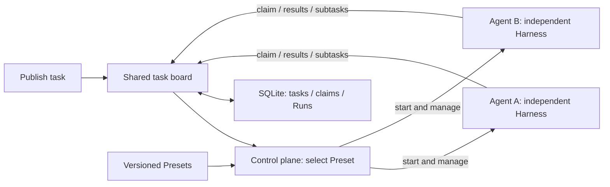

<p align="center">
  
</p>

# Harness³

**A shared task board for peer Agents, built on a composable Rust runtime.**

Publish a task without choosing an Agent. The control plane selects a Preset and starts an independent instance; that Agent claims work, executes it, and can return smaller tasks to the board. The same cycle provisions the next participants. Every Agent uses the same Harness model/tool loop, specialized by its Preset, with no permanent leader.

[简体中文](README.zh-CN.md) · [Documentation](docs/README.md) · [Architecture](docs/managed-agents.zh-CN.md) · [Current status](docs/status.zh-CN.md) · [Contributing](CONTRIBUTING.md)

## See your Agents at work


Crew animations follow real execution state: typing, waiting, or sleeping. Select a crew member to inspect its task; switch views to see task dependencies and system structure. Open **Agent 工作现场** in the local console.

## Start locally

Requires **Rust 1.89+**. The deterministic Demo needs no model account or API key; Cargo downloads dependencies on the first build.

```sh
git clone https://github.com/NeoPanic/harness3.git
cd harness3
cargo run --locked -p harness3-platform -- up --demo
```

Open [localhost:7333](http://127.0.0.1:7333) and sign in with the contents of `.harness3/token`. Local state is stored in `.harness3/`.

1. Open **任务板** (Task Board) and publish the work and its acceptance criteria.
2. Follow Preset selection, instance startup, and the Agent's claim and execution.
3. Inspect any subtasks returned to the board and their results in **Agent 工作现场**.

The Demo exercises the real control plane with deterministic responses; its outputs are explicitly labeled as demonstrations and do not constitute external research. The [task-board guide](docs/task-board.zh-CN.md) describes routing, claiming, splitting, and current limits. The existing **自主调研** screen remains available as an explicit planning/research/synthesis workflow template.

For real models, configure one of **OpenAI-compatible Chat Completions**, **OpenAI Responses**, or **Anthropic Messages**. See the [getting-started guide](docs/getting-started.zh-CN.md) for configuration, CLI/API/MCP usage, and trusted local process plugins.

## Console example

The local desktop console, shown with Demo data.


## What you can use

| Area | Available behavior |
| --- | --- |
| Agent definitions | Versioned Presets, pinned inheritance, parameters, model and plugin bindings. |
| Lifecycle | Independent instances; Agent pools for provisioning, scaling, retirement, and TTL. |
| Shared task board | Publish unassigned tasks; select Presets, provision instances, claim work atomically, and return subtasks. |
| Explicit workflows | Existing Goal graphs, candidate-based claiming, bounded delegation, and research templates. |
| Collaboration | Direct messages, Goal channels, explicit membership, subscribed wake-ups, shared context. |
| Deliverables | Private workspaces, immutable text/file/JSON snapshots, peer evidence handoffs. |
| Review | Independent verification, evidence-linked repair, review rounds, human acceptance. |
| Extension | Prompt packages and local process Tool plugins with pinned versions and health checks. |
| Access | Desktop Web, HTTP API, CLI, and outward MCP stdio share persistent local state. |

Agent pools manage resources from one Preset. Task-board work starts from a published task and provisions its own participants. Goal workflows provide separate channel, artifact, and review contracts; their capabilities are not automatically implied by a task-board result.

<details>
<summary>Explore the running Demo: team collaboration and workspace artifacts</summary>

**Team collaboration.** Members, subscriptions, and discussion records remain inspectable after the team retires.


**Workspace evidence.** Shared immutable snapshots retain their source Agent and Run; private instance files are listed separately.


</details>

This is a **pre-1.0 local platform for trusted environments**. Local defaults include 256 instances, 8 execution slots, and 64 tasks per Goal; these are configured limits, not measured capacity claims. Distributed scheduling, hosted deployment, strong multi-tenant isolation, and remote MCP plugin loading are not provided. See [current status](docs/status.zh-CN.md) and the [capability/source index](docs/capabilities.zh-CN.md) for precise boundaries.

## Architecture



The control plane manages capacity, Preset selection, and lifecycle. Agents share the claim and split protocol; planning and integration are work that ordinary instances can perform. Task ancestry records dependencies and provenance, without giving an Agent authority over its peers. The independent Harness owns model/tool execution, policies, session checkpoints, cancellation, and execution receipts. Checkpoints do not guarantee exactly-once external effects: tools must supply their own idempotency or transaction contract. See [runtime contracts](docs/runtime.md) and the [target architecture](docs/managed-agents.zh-CN.md).

## Use the runtime independently

```sh
cargo run --locked --example quickstart
```

The [offline example](examples/quickstart.rs) runs a model → tool → model cycle, then redelivers the same event to demonstrate session deduplication.

```toml
[dependencies]
harness3 = { git = "https://github.com/NeoPanic/harness3.git", branch = "main" }
```

```rust
use harness3::{Harness, Limits, Registry};

let harness = Harness::new(Registry::default(), Limits::default());
```

Register capabilities as shown in the complete example. Pin a Git revision for reproducible builds. API reference: `cargo doc --locked --workspace --no-deps --open`.

## Why the cube?

> 道生一，一生二，二生三，三生万物。 — *Dao De Jing*, chapter 42

The **³** connects the generative meaning of 三 with multiplication: harness × harness × harness, extending to N cooperating harnesses. Use **Harness³** in prose and `harness3` for code and repository identifiers. [Brand assets and usage](docs/brand/README.md).

## Contribute

See [development checks](CONTRIBUTING.md), [security reporting](SECURITY.md), and the [code of conduct](CODE_OF_CONDUCT.md). The [documentation index](docs/README.md) links setup, design goals, current capabilities, and workflow contracts.

[MIT license](LICENSE).
