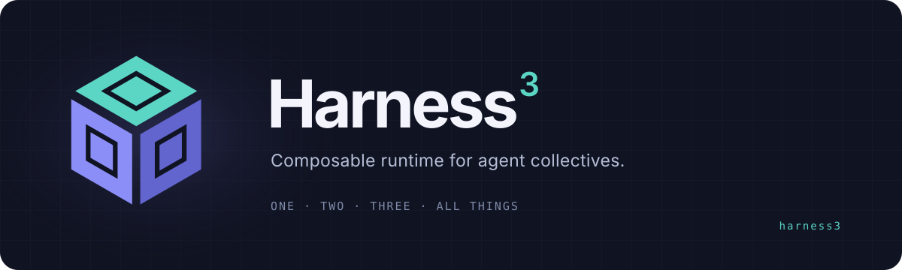
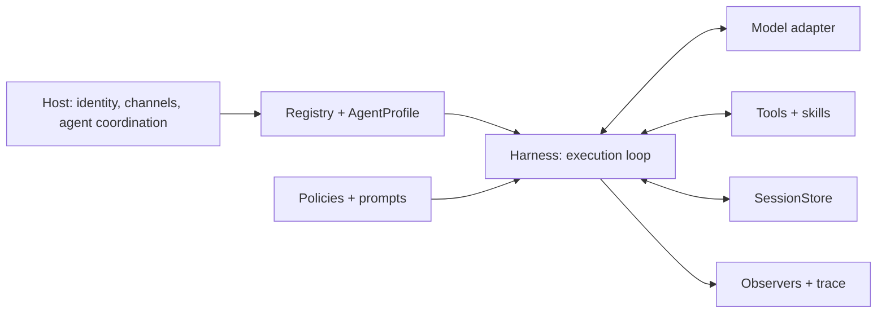

<p align="center">
  
</p>

<p align="center">
  <a href="https://github.com/NeoPanic/harness3/actions/workflows/check.yml"></a>
  <a href="https://www.rust-lang.org"></a>
  <a href="LICENSE"></a>
</p>

<p align="center"><a href="README.zh-CN.md">简体中文</a> · <a href="docs/runtime.md">Runtime contracts</a> · <a href="GUIDE.zh-CN.md">中文技术导读</a> · <a href="CONTRIBUTING.md">Contributing</a></p>

# Harness³

**A composable harness platform for agent collectives. Built in Rust.**

Harness³ gives agents a shared execution foundation: model and tool interfaces, explicit authority, recoverable conversations, and inspectable execution. A host can compose these foundations into larger agent systems while choosing its own models, storage, channels, and coordination strategy.

This repository contains the independent **runtime core** and a **local control-plane preview** with Presets, independent instances, SQLite persistence, and an embedded Web console. Explicit task graphs now coordinate multiple instances with dependency evidence and human acceptance. Multi-machine scheduling, autonomous delegation, external executable plugins, and hosted deployment remain planned.

## Local kernel platform preview

```sh
cargo run --locked -p harness3-platform -- up --demo
```

Open [http://127.0.0.1:7333](http://127.0.0.1:7333) and sign in with the local `.harness3/token` file. Publish Presets, create independent instances, run the real Harness loop, and inspect requests, receipts, sessions, events, and implementation status. The platform supports non-streaming OpenAI-compatible Chat Completions, OpenAI Responses, and Anthropic Messages adapters. See the [platform guide (中文)](docs/kernel-preview.zh-CN.md) for model configuration, API endpoints, and current limits. Shared goals support explicit task dependencies, contribution handoff, and human review through Web, API, and the goals CLI. Autonomous agent messaging and external code plugins remain planned.

## Why the cube?

> 道生一，一生二，二生三，三生万物。
>
> The Dao gives rise to one; one to two; two to three; three to all things.

The **³** draws on this passage from chapter 42 of the *Dao De Jing*: simple foundations can generate a multitude. The cube also expresses multiplication: harness × harness × harness, extending to N cooperating harnesses. This is the project's design direction; actual capacity depends on the host and its resources.

Use **Harness³** in prose, `harness³` as its lowercase styling, and **`harness3`** for the repository, Cargo package, and Rust imports. See the [brand assets and usage guide](docs/brand/README.md).

## What the core provides

| Foundation | Behavior |
| --- | --- |
| Composable capabilities | Register models, tools, skills, prompts, policies, and typed services without changing the loop. |
| Durable session contract | Revision-fenced checkpoints, delivery deduplication, exact request snapshots, replay, and forks. A memory store is included; production persistence is a host adapter. |
| Controlled execution | Task-scoped tools, ordered policies, cancellation, deadlines, and explicit outbound delivery. |
| Tool concurrency | Independent read tools can opt into batches of up to four; mutations and policy-controlled execution preserve ordering. |
| Context management | Budget-aware summarization preserves complete exchanges, receipts, and the current request. |
| Execution visibility | Ordered observer events and a bounded in-process trace; hosts can attach a trace sink. |

Tools run as trusted in-process Rust code. External writes still require tool-side idempotency or transactions; checkpoints alone cannot guarantee exactly-once effects. Read the [runtime contracts](docs/runtime.md) before implementing durable integrations.

## Run in a minute

Requires **Rust 1.89+**. The example uses a deterministic local model and an in-memory session store; no API keys, network calls, or database are needed after dependencies are installed.

```sh
git clone git@github.com:NeoPanic/harness3.git
cd harness3
cargo run --locked --example quickstart
```

Expected output:

```text
Harness³: 8 characters.
Duplicate delivery reused the settled run: true
```

The [example](examples/quickstart.rs) registers a source, a model, a character-counting tool, and an agent profile. It runs a model → tool → model cycle, then redelivers the same event to demonstrate session deduplication. Replace the model adapter to connect a real provider.

## Use in your Rust project

```toml
[dependencies]
harness3 = { git = "https://github.com/NeoPanic/harness3.git", branch = "main" }
```

```rust
use harness3::{Harness, Limits, Registry};

let harness = Harness::new(Registry::default(), Limits::default());
```

Register capabilities before running a request, as shown in the complete example. Use `Harness::run_session` with a `SessionStore` for continuing conversations; `Harness::run` creates an isolated ephemeral conversation. Pin a Git revision for reproducible downstream builds. The dependency above uses Git and makes no crates.io availability claim.

Earlier checkouts used the package name `agent-harness` and import `agent_harness`. Update those to `harness3`; the `Harness` type and execution contracts retain their names.

## Architecture



Each harness supplies an execution boundary. The host defines how agents share work, select capabilities, and exchange results; the core keeps those choices replaceable through traits and `AgentDriver`.

## Documentation

- [Managed Agents architecture proposal (中文)](docs/managed-agents.zh-CN.md): Presets, N-instance control plane, plugin hot loading, three model protocols, target source layout, and local experience; the full target is subject to the documented acceptance gates.
- [Implementation status and module mapping (中文)](docs/implementation-status.zh-CN.md): shared with the Web console; records shipped behavior, gaps, verification, and planned source paths.
- [中文首页](README.zh-CN.md): positioning, setup, and naming in Chinese.
- [中文技术导读](GUIDE.zh-CN.md): sequence diagrams, source walkthrough, and design reasoning.
- [Runtime contracts](docs/runtime.md): recovery, authorization, compaction, delivery, and trace semantics.
- [Runnable example](examples/quickstart.rs): an offline integration from registration to receipt.
- API reference: `cargo doc --locked --no-deps --open`.
- [Contributing](CONTRIBUTING.md), [security reporting](SECURITY.md), and [community conduct](CODE_OF_CONDUCT.md).

## Project status and development

The core is at **0.2.7**, before a stable 1.0 API. The originating application's behavior suite has not been migrated. The platform now has standalone integration coverage for versions, idempotency, lifecycle, cancellation, persistence, recovery, and model protocols. CI runs workspace compilation, Clippy, tests, rustdoc, and the offline example on Rust 1.89 and stable; distributed scheduling and executable plugin failures remain future work.

```sh
cargo check --locked --all-targets
cargo test --locked
cargo run --locked --example quickstart
RUSTDOCFLAGS="-D warnings" cargo doc --locked --no-deps
```

Bug reports should include a minimal reproduction and the violated runtime contract. Propose changes to persistence, authority, or cancellation semantics in an issue before implementing them. See [Contributing](CONTRIBUTING.md) for the review workflow.

## License

[MIT](LICENSE). The original copyright notice is retained; see the [brand guide](docs/brand/README.md) for attribution and identity usage.
