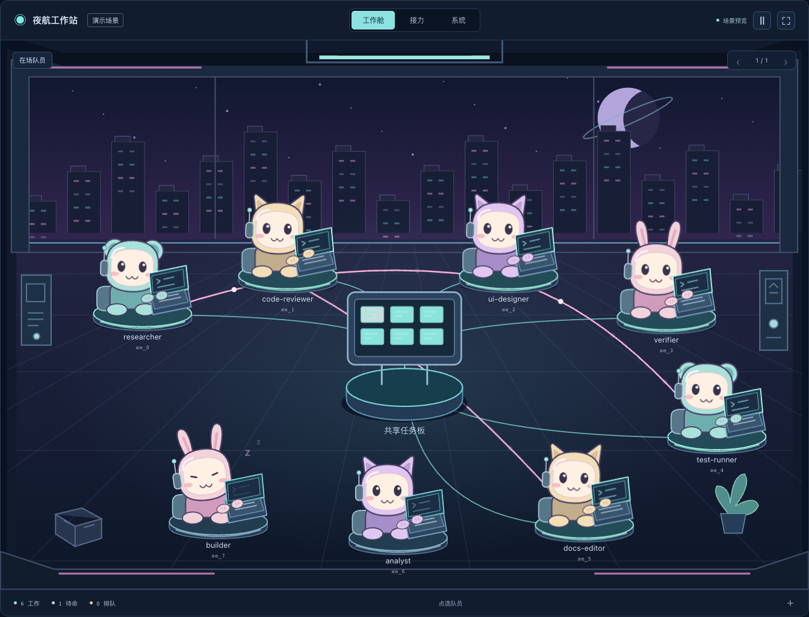
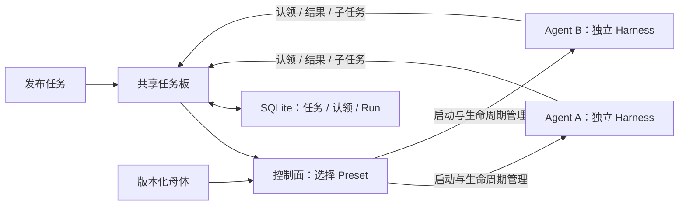

<p align="center">
  
</p>

# Harness³

**让对等 Agent 围绕共享任务板协作，基于可组合的 Rust 运行内核。**

发布任务时无需选择 Agent。控制面根据任务选择 Preset、启动独立实例，Agent 认领后执行，也可以把细分任务投回任务板，触发下一轮按需启动。每个 Agent 使用同一套 Harness 模型 / 工具循环，由 Preset 注入专业能力，没有固定 leader。

[English](README.md) · [文档导航](docs/README.md) · [架构设计](docs/managed-agents.zh-CN.md) · [当前状态](docs/status.zh-CN.md) · [参与贡献](CONTRIBUTING.md)

## 看见 Agent 在工作



打字、待命、休眠，队员动作由真实执行状态驱动。点击角色检查任务，切换视图查看任务接力和系统架构。在本地控制台进入 **Agent 工作现场** 即可查看。

## 本地启动

需要 **Rust 1.89+**。确定性 Demo 无需模型账号或 API Key；首次编译由 Cargo 下载依赖。

```sh
git clone https://github.com/NeoPanic/harness3.git
cd harness3
cargo run --locked -p harness3-cli -- up --demo
```

打开 [localhost:7333](http://127.0.0.1:7333)，使用 `.harness3/token` 的内容登录。本地状态保存在 `.harness3/`。

1. 进入 **任务板**，发布工作要求与验收标准。
2. 查看 Preset 选型、实例启动、Agent 认领与执行状态。
3. 在 **Agent 工作现场** 检查回投的子任务、参与实例与结果。

Demo 使用确定性响应运行真实控制面，输出明确标记为演示，不代表外部调研结果。[任务板指南](docs/task-board.zh-CN.md)说明选型、认领、拆分和当前边界。已有的 **自主调研** 页面保留为显式选择的规划 / 研究 / 汇总流程模板。

真实模型支持 **OpenAI-compatible Chat Completions、OpenAI Responses、Anthropic Messages** 三种协议。模型配置、CLI / API / MCP 用法与可信本地进程插件设置见[入门指南](docs/getting-started.zh-CN.md)。

## 控制台示例

以下为本地桌面控制台的 Demo 数据示例。


## 当前可以做什么

| 范围 | 可用行为 |
| --- | --- |
| Agent 定义 | 版本化母体、固定版本继承、参数、模型与插件绑定。 |
| 生命周期 | 独立实例；Agent 池统一创建、扩缩容、排空回收与 TTL。 |
| 共享任务板 | 发布未绑定实例的任务；控制面选型、启动，Agent 原子认领并回投子任务。 |
| 显式流程 | 兼容 Goal 依赖图、候选实例领取、有限委派与固定调研模板。 |
| 协作空间 | 点对点消息、目标频道、显式成员、订阅唤醒与共享上下文。 |
| 工作成果 | 私有文件工作区、不可变文本 / 文件 / JSON 快照、跨 Agent 证据交接。 |
| 质量闭环 | 独立验证、证据驱动的局部修复、评审轮次与人工验收。 |
| 能力扩展 | 提示词包、本地进程工具插件、固定版本绑定与健康检查。 |
| 使用入口 | 桌面 Web、HTTP API、CLI、对外 MCP stdio 共用本地持久状态。 |

Agent 池管理同一母体的实例资源；任务板从发布任务开始，按需创建参与实例。Goal 流程另有频道、产物与验收契约，任务板结果不自动继承这些能力。

<details>
<summary>展开查看当前 Demo：团队协作与文件产物</summary>

**团队协作。** 团队回收后仍可检查成员、订阅关系和讨论记录。


**工作区证据。** 共享快照保留来源 Agent 与 Run，实例私有文件单独列出。


</details>

当前为面向**可信本地环境的 pre-1.0 平台**。默认上限为 256 个实例、8 个执行槽和每个 Goal 64 项任务；这些是配置限制，不代表实测容量。分布式调度、托管部署、强多租户隔离和远程 MCP 插件加载尚未提供。准确边界见[当前状态](docs/status.zh-CN.md)与[能力及源码索引](docs/capabilities.zh-CN.md)。

## 架构分层



控制面负责容量、Preset 选型与生命周期。Agent 共用认领和拆分协议，规划与整合由普通实例承担；任务父子关系记录依赖和来源，不赋予 Agent 管理同伴的权限。独立 Harness 负责模型 / 工具循环、策略、会话检查点、取消和执行回执。检查点不能独自保证外部副作用恰好执行一次，工具需提供自己的幂等或事务契约。详见[运行契约](docs/runtime.md)与[目标架构](docs/managed-agents.zh-CN.md)。

## 单独使用 Rust 内核

```sh
cargo run --locked --example quickstart
```

[离线示例](examples/quickstart.rs)演示模型 → 工具 → 模型循环，再重复投递同一事件，验证会话去重。

```toml
[dependencies]
harness3 = { git = "https://github.com/NeoPanic/harness3.git", branch = "main" }
```

```rust
use harness3::{Harness, Limits, Registry};

let harness = Harness::new(Registry::default(), Limits::default());
```

完整能力注册参照示例。下游项目应固定 Git revision，保证构建可复现。API 文档：`cargo doc --locked --workspace --no-deps --open`。

## 为什么是立方？

> 道生一，一生二，二生三，三生万物。——《道德经》第四十二章

**³** 同时表达“三生万物”和组合相乘：harness × harness × harness，延伸到 N 个协作的 harness。正文品牌为 **Harness³**，代码与仓库标识为 `harness3`。[品牌素材与使用规范](docs/brand/README.md)。

## 参与项目

参阅[开发与检查流程](CONTRIBUTING.md)、[安全报告](SECURITY.md)和[行为准则](CODE_OF_CONDUCT.md)。[文档导航](docs/README.md)按入门、当前能力、设计目标和专题契约组织资料。

[MIT 许可证](LICENSE)。
