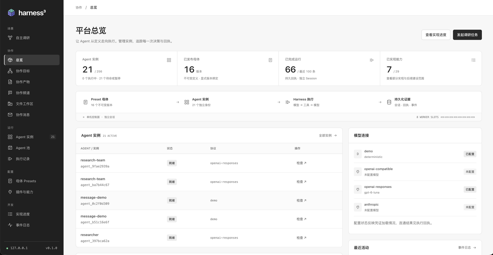
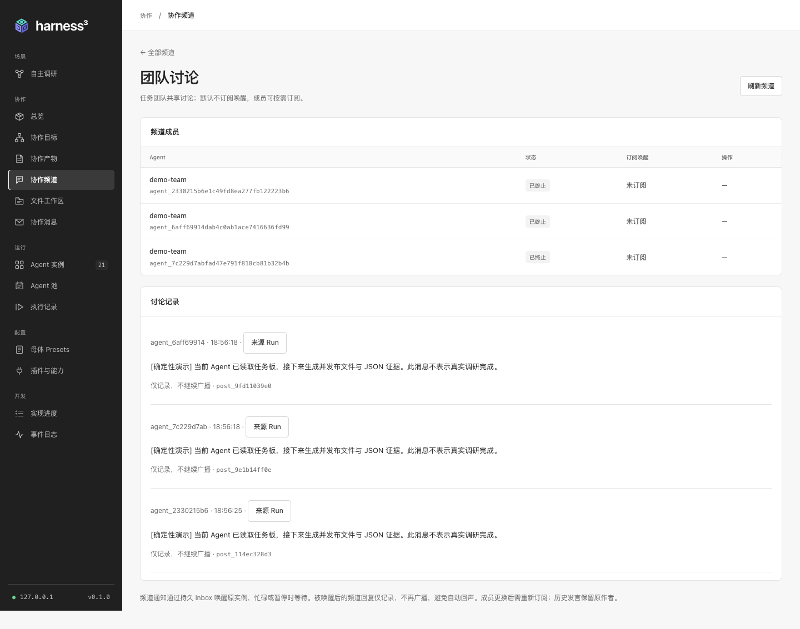
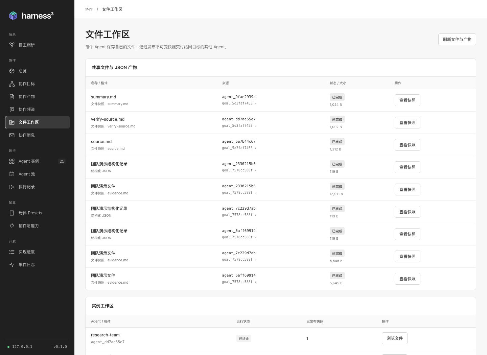
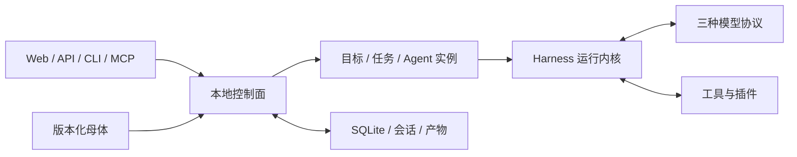

<p align="center"></p>

# Harness³

**为 Agent 集群打造的本地 Managed Agents 平台，基于可组合的 Rust 运行内核。**

用 Preset 定义 Agent 母体，启动独立实例，围绕共同目标组建团队。Harness³ 在统一控制面管理实例生命周期、任务依赖、协作频道、文件产物、独立验证与人工验收，让每次执行都有可检查的过程和证据。

[English](README.md) · [文档导航](docs/README.md) · [架构设计](docs/managed-agents.zh-CN.md) · [当前状态](docs/status.zh-CN.md) · [参与贡献](CONTRIBUTING.md)



## 本地启动

需要 **Rust 1.89+**。确定性 Demo 无需模型账号或 API Key；首次编译由 Cargo 下载依赖。

```sh
git clone https://github.com/NeoPanic/harness3.git
cd harness3
cargo run --locked -p harness3-platform -- up --demo
```

打开 [localhost:7333](http://127.0.0.1:7333)，使用 `.harness3/token` 的内容登录。本地状态保存在 `.harness3/`。

1. 进入 **自主调研**，选择 `demo-team@1.0.0` 创建任务。
2. 检查规划、参与 Agent、任务依赖与各自的 Run。
3. 沿着频道讨论与文件 / JSON 证据，查看汇总、验证和验收过程。

Demo 使用确定性响应运行真实控制面，输出明确标记为演示；它不执行外部调研，也不自主追加任务。配置真实 Responses 模型后，可选择 `research-team@1.1.0`，让 Agent 按需要请求追加工作。

真实模型支持 **OpenAI-compatible Chat Completions、OpenAI Responses、Anthropic Messages** 三种协议。模型配置、CLI / API / MCP 用法与可信本地进程插件设置见[入门指南](docs/getting-started.zh-CN.md)。

## 当前可以做什么

| 范围 | 可用行为 |
| --- | --- |
| Agent 定义 | 版本化母体、固定版本继承、参数、模型与插件绑定。 |
| 生命周期 | 独立实例；Agent 池统一创建、扩缩容、排空回收与 TTL。 |
| 团队执行 | 规划、任务依赖、候选实例领取、有限递归委派与后续任务追加。 |
| 协作空间 | 点对点消息、目标频道、显式成员、订阅唤醒与共享上下文。 |
| 工作成果 | 私有文件工作区、不可变文本 / 文件 / JSON 快照、跨 Agent 证据交接。 |
| 质量闭环 | 独立验证、证据驱动的局部修复、评审轮次与人工验收。 |
| 能力扩展 | 提示词包、本地进程工具插件、固定版本绑定与健康检查。 |
| 使用入口 | 桌面 Web、HTTP API、CLI、对外 MCP stdio 共用本地持久状态。 |

Agent 池管理同一母体的实例资源，团队围绕 Goal 协作。创建池不会自动启动协作任务。

<details>
<summary>展开查看当前 Demo：团队协作与文件产物</summary>

**团队协作。** 团队回收后仍可检查成员、订阅关系和讨论记录。



**工作区证据。** 共享快照保留来源 Agent 与 Run，实例私有文件单独列出。



</details>

当前为面向**可信本地环境的 pre-1.0 平台**。默认上限为 256 个实例、8 个执行槽和每个 Goal 64 项任务；这些是配置限制，不代表实测容量。分布式调度、托管部署、强多租户隔离和远程 MCP 插件加载尚未提供。准确边界见[当前状态](docs/status.zh-CN.md)与[能力及源码索引](docs/capabilities.zh-CN.md)。

## 架构分层



控制面负责协作与生命周期；独立内核负责模型 / 工具执行、策略、会话检查点、取消和执行回执。检查点不能独自保证外部副作用恰好执行一次，工具需提供自己的幂等或事务契约。详见[运行契约](docs/runtime.md)与[目标架构](docs/managed-agents.zh-CN.md)。

## 单独使用 Rust 内核

```sh
cargo run --locked --example quickstart
```

[离线示例](examples/quickstart.rs)演示模型 → 工具 → 模型循环，再重复投递同一事件，验证会话去重。

```toml
[dependencies]
harness3 = { git = "https://github.com/NeoPanic/harness3.git", branch = "main" }
```

```rust
use harness3::{Harness, Limits, Registry};

let harness = Harness::new(Registry::default(), Limits::default());
```

完整能力注册参照示例。下游项目应固定 Git revision，保证构建可复现。API 文档：`cargo doc --locked --workspace --no-deps --open`。

## 为什么是立方？

> 道生一，一生二，二生三，三生万物。——《道德经》第四十二章

**³** 同时表达“三生万物”和组合相乘：harness × harness × harness，延伸到 N 个协作的 harness。正文品牌为 **Harness³**，代码与仓库标识为 `harness3`。[品牌素材与使用规范](docs/brand/README.md)。

## 参与项目

参阅[开发与检查流程](CONTRIBUTING.md)、[安全报告](SECURITY.md)和[行为准则](CODE_OF_CONDUCT.md)。[文档导航](docs/README.md)按入门、当前能力、设计目标和专题契约组织资料。

[MIT 许可证](LICENSE)。
