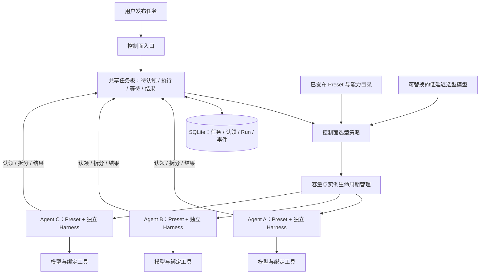

# Harness³ Managed Agents 架构设计

本文定义平台的目标架构、领域边界、状态约束和模块布局。可用能力与限制见[当前平台状态](status.zh-CN.md)，运行步骤和接口用法见[平台使用指南](getting-started.zh-CN.md)。文中的扩展接口和目标目录用于架构约束，不表示对应能力均已提供。

## 1. 产品目标与交付边界

Harness³ 的目标是让用户发布任务后，由平台按需组织对等 Agent 工作。用户通过控制面将工作要求和验收标准写入共享任务板，无需预选 Agent 或 Preset。控制面扫描任务、选择适合的已发布 Preset、启动独立实例并管理生命周期；实例启动后认领任务，执行或拆分，再把细分任务投回任务板。新任务进入同一循环。

Harness 是包含模型 / 工具循环、会话和回执的标准运行件；Preset 为它注入指令、模型协议与工具能力，形成不同用途的 Agent。全部 Agent 使用同一协作协议，系统没有固定 leader。规划、研究、评审和整合可以是任务内容，不能成为内核强制的身份等级。

每个 Agent 拥有独立的配置、会话、能力权限和工作区；平台提供共享任务上下文、可靠消息、任务认领、产物验证与整合。首次体验应能解释“哪个 Agent 因为什么在做什么、交付了什么、结果如何验证、发生故障后如何处理”。

平台交付涵盖运行时、控制面、存储、Worker、模型适配器、四类入口和可操作的协作演示。演示必须产生真实调度、工具回执与产物证据。

品牌中的 N 个 harness 相乘表达可组合性。架构不预设三个 Agent 或固定角色数量；实例规模由控制面按配额、预算与 Worker 容量管理。无限衍生表达开放的组合空间，实际实例创建、派生深度、并发和存续时间都受显式资源约束。

平台采用“一切能力皆插件”的扩展范式：模型、工具、外部工具连接器、技能、提示词、渠道与策略通过统一插件描述、安装、绑定和版本管理。核心保留不可绕过的状态、权限、回执和生命周期契约。官方模型接入范围限定为 OpenAI-compatible Chat Completions、OpenAI Responses、Anthropic Messages 三类协议。

## 2. 领域边界

| 层 | 负责 | 不承担 |
| --- | --- | --- |
| Harness 内核 | 单次模型/工具循环、会话、观察与回执、取消 | 团队规划、实例数量、跨 Agent 任务所有权 |
| 控制面 | Preset 发布与动态选型、容量、Agent 池与实例生命周期、能力绑定 | 将选型模型变成指挥其他 Agent 的永久 leader |
| 组织服务 | 共享任务板、原子认领、任务来源与结果；Goal 流程中的消息/频道、共享事实、产物与验收 | 直接读写模型私有推理、跳过平台状态校验 |
| 调度与执行 | 持久队列、执行容量、所有权、等待/恢复 | 将进程或 Worker 身份等同于 Agent 身份 |
| 插件宿主 | 包校验、版本快照、装配、调用、健康与撤销 | 允许外部代码自行声明平台权限 |
| 入口适配器 | HTTP、CLI、MCP、Web 的命令与查询映射 | 各自创建数据库、执行循环或独立状态 |

领域中立的运行内核保留独立使用方式。平台协调逻辑通过应用服务和端口组合，不进入单 Agent 执行循环。

## 3. 理论基础如何落实

平台采用“观察模型输出 → 执行工具 → 返回观察”的交互循环，以明确的系统模型描述多 Agent 身份、协作、执行与验证。理论基础用于形成可审查契约，不承担正确性证明。

| 基础 | 用途 | 需要写成的工程契约 |
| --- | --- | --- |
| 部分可观测决策、ReAct 式观察/行动循环 | 模型只掌握有限历史和工具观察，必须区分事实、推测与结果 | Observation、证据引用、工具回执、终止条件；不能用自述的成功代替工具证据 |
| Actor 模型 | Agent 具有独立身份、局部状态，通过消息协作 | 每个会话的有效写入者、持久 Inbox、消息 envelope、监督与唤醒；Agent 不等于常驻进程 |
| 共享黑板与组织协作协议 | 让多个 Agent 围绕共同目标发布证据与贡献 | 共享目标/任务/产物的版本、可见范围、认领规则、冲突裁决；无需共享所有私有思考历史 |
| 状态机与持久执行 | 把意图、认领、执行、回执和结算连接起来 | 转移前置条件、事务边界、幂等键、检查点、恢复路径、结果未知的处置 |
| 分布式系统的租约与 fencing | Worker 断连后可能仍在运行，旧所有者不能继续提交有效状态 | 单调 generation、存储写入校验、执行端凭证或隔离；仅有超时或心跳缺失不足以证明旧进程已停止 |
| 最小权限与能力委派 | 工具调用与 Agent 消息不能自行扩大权限 | Principal、scope、凭证引用、预算上限；子任务的有效权限不得超过委派者和目标 Agent 权限的交集 |
| 反馈控制与评估 | 让系统依据外部结果修正执行，而非只累积文字 | 明确验收标准、独立验证、有限重做、停止/升级条件；比较单 Agent 与协作系统的质量、成本和耗时 |

“收集 → 认领 → 行动 → 验证 → 整合”适合作为组织协作的逻辑阶段。阶段允许回退和并发，不能强制所有任务按固定五步选择工具。工具策略与任务分解可由模型决定，权限、状态转移、费用边界和证据校验由平台执行。

规格覆盖母体/实例对象与状态、插件与三类模型协议、消息与委派、故障与恢复、权限/预算与评估。任务分配算法、复杂规划和长期记忆应作为可替换策略，与平台状态约束分离。

参考入口：[ReAct](https://arxiv.org/abs/2210.03629)、[Actor Model of Computation](https://arxiv.org/abs/1008.1459)、[Lamport：Time, Clocks, and the Ordering of Events](https://lamport.azurewebsites.net/pubs/time-clocks.pdf)。这些是设计背景，不构成对 Harness³ 正确性或性能的证明。

持久编排与协作领域的边界及 Temporal 概念对照见[多 Agent 协作与 Durable Workflow](durable-workflows.zh-CN.md)。

## 4. 目标架构



入口通过同一控制面服务，共用应用命令、权限检查、对象 ID、幂等和错误语义。新任务板提供 Web、HTTP 与 CLI；已有 MCP 提供其已声明的命令，不应自行创建 Registry、数据库或另一个执行循环。

控制面负责“按当前任务需要启动哪些能力”；组织服务负责“工作如何被认领、拆分、共享和结算”；Harness 负责“一次执行如何与模型和工具交互并留下可信回执”。选型模型输出已发布 Preset 的名称、版本和理由，平台校验后才创建实例。模型决定不能绕过容量、权限与状态检查。

集中式控制面与 SQLite 提供公共基础设施；Agent 的对等地位由统一协作协议保证。任务父子关系只表达拆分来源和结果依赖，不能推出 Agent 的上下级关系。Rust 的并发运行时可降低实例装配和调度开销，模型推理与外部工具延迟仍由对应服务决定。

本地部署将控制面、组织服务、调度器和嵌入式 Worker pool 装配在一个守护进程中，使用 SQLite 与本地文件存储。进程内分层保留多进程 Worker、PostgreSQL、多机器与容器后端的适配边界。可信进程内/本地插件运行与容器级安全隔离属于不同执行模式。

## 5. 核心对象与不变量

| 对象 | 职责 |
| --- | --- |
| AgentPreset / PresetVersion | 用户定义的母体 Agent：主要功能、默认目标、指令、模型、插件、权限和资源配置；发布版本不可变，可有显式继承关系 |
| SpawnOperation / AgentFleet | 一次批量创建的进度与结果，以及持续管理 N 个同类实例的实例组；记录期望数量、当前数量和扩缩容策略 |
| AgentInstance | PresetVersion 的独立实例，含唯一 ID、实例参数、工作区、身份、生命周期与派生来源；不可变母体快照不与兄弟实例共享可变会话 |
| PluginPackage / PluginVersion / PluginBinding | 外部插件包、内容寻址的不可变版本，以及某 Preset/实例获准使用的能力和配置绑定 |
| Worker / WorkerSlot | 执行容量与所有者身份；一个 Worker 可执行多个 Agent 的不同会话，不能把 Worker ID 当作 Agent ID |
| Goal | 用户意图、验收标准、根预算、截止时间及最终状态 |
| WorkItem | 可认领的工作单元，含依赖、认领者、generation、允许的尝试与产物要求；与运行请求中的 profile 选择键分离 |
| BoardTask | 发布时无实例绑定的任务，包含要求、验收标准、根任务和拆分来源；选型、实例启动和认领分别留痕 |
| Session / Run / Attempt | 会话历史、单次输入执行、某 WorkItem 的一次尝试；调度重试不能覆盖旧 Run 结果 |
| Message / Inbox / Outbox | 消息内容、待消费状态、待可靠发送状态；统一 message_id、causation_id、correlation_id、作用域与权限 |
| Artifact / Contribution / Review | 版本化输出、某次尝试的提交、基于指定版本和标准的验收证据 |
| Principal / Grant / BudgetReservation | 谁在操作、获准做什么、执行前预留的额度；密钥本体不进入消息或日志 |
| PlatformEvent / AuditRecord | 可重放的平台事实与权限操作记录；与可丢失的调试 Trace 分开存储 |

目标系统遵循以下不变量；具体部署支持的约束由其执行后端和能力声明确定：

1. 同一会话只有一个有效写入所有者；旧 Worker 的 generation 不能写入新所有者状态。存储 fencing 不会撤销已经发出的外部请求，外部效果还需执行端的幂等、凭证撤销或隔离。
2. WorkItem 的认领、Attempt 创建、预算预留和相关 Outbox 记录在可证明的事务边界内提交；跨存储操作通过可恢复协议衔接。
3. 消息默认至少一次投递，消费者以稳定键去重。应用命令另有作用域内幂等键与内容指纹，不把不同入口的同一请求当作不同任务。
4. 宿主身份从认证上下文取得；不能信任客户端填入 `InboundEvent.payload.context` 的 principal、权限或预算。Source 适配层负责显式映射与保留字段过滤。
5. 共享上下文保存版本化事实、证据与产物引用；Agent 私有会话不自动广播，任务数据和检索文本不获得指令权限。
6. 模型提出“完成”只会提交待验收贡献；Goal 成功需要满足验收标准的 Review，以及已持久化的整合产物。
7. 预算预留在调用前原子检查，调用后按供应商 usage 对账；缺失 usage 标记未知并保守处理。费用硬上限需要明确提供商限价、单次输出限制及进行中请求的结算边界，不能仅靠事后累计。
8. 取消停止新增工作并向子任务传播，已开始的操作进入收尾。无法证实外部结果时保留 outcome-unknown，不能把它展示为已回滚或可安全重试。
9. 发布任务无需实例或 Preset 身份。启动实例不构成认领，任务所有权必须经过原子认领；同一任务同时至多有一个有效执行者。
10. 任务拆分由 Agent 提出，子任务的 Preset 选型由控制面处理。拆分记录保留来源，不能授予来源 Agent 管理新实例的权力。

## 6. 状态与协作闭环

WorkItem 主路径：

```mermaid
stateDiagram-v2
    [*] --> queued
    queued --> claimed: 事务认领与预算预留
    claimed --> running: 所有权确认
    running --> waiting: 等待依赖/消息/审批
    waiting --> queued: 唤醒条件满足
    running --> review_pending: 提交贡献
    review_pending --> completed: 验证与整合通过
    review_pending --> queued: 有界返工
    running --> outcome_unknown: 无法确认外部效果
    running --> failed: 确定失败且不能继续
    queued --> cancelled: 取消
    waiting --> cancelled: 取消
    running --> cancelling: 停止新增动作
    cancelling --> cancelled: 已确认收尾
    cancelling --> outcome_unknown: 收尾结果不明
    claimed --> queued: 确认未开始且释放所有权
```



图展示主路径；实施前还需转移表，定义各状态的超时、取消、权限撤销与预算耗尽行为。例如 review_pending 的取消必须处理已存在的贡献，不能抹去历史。Task 状态与 Attempt/Run 状态分别保存：WorkItem 被唤醒重排队，旧 Attempt 的结算事实仍然存在。

默认任务流：用户发布工作 → 任务板持久接纳 → 控制面按任务与能力目录选型 → 启动 Preset 实例 → Agent 原子认领 → 工具行动或拆分子任务 → 子任务回板触发新一轮选型 → 收齐子任务结果后，原任务重新可认领 → 普通实例整合结果。

已有自主调研保留固定规划 / 研究 / 汇总模板，显式 Goal 保留候选实例和依赖图；它们是兼容用例。新任务板不要求这些角色，后续整合也不要求原实例继续执行。拆分需要最大深度、最大子任务数和总任务数限制；启用费用治理时还需限定总预算，防止循环拆分和消息风暴。

上面的状态图描述包含预算、验证和验收的目标契约。新任务板当前保存认领、Run、拆分与结果，尚未接入 Goal 的独立验证和人工验收；任务 `completed` 表示已知执行成功，不代表验收标准已经由独立评审证明。具体状态与接口见[共享任务板](task-board.zh-CN.md)。

等待应当是持久状态：记录等待条件、释放 Worker，唤醒时生成后续 Attempt 和输入事件。保持一个异步 future 挂起无法代替持久等待协议，会占用执行容量且无法独立处理进程重启。

恢复至少区分三种情况：尚未开始的工作可重新认领；有完整回执的操作复用证据；已开始且结果未知的操作先对账或等待人工裁决。中断结算只是恢复协议的一步：宿主先证明旧运行已停止，再结算中断记录，之后显式创建续行事件。恢复记录与自动断点续跑需要分别定义。

## 7. 母体 Agent、批量实例化与生命周期

### 7.1 Preset 是可发布的母体定义

母体 Agent 用 `AgentPreset` 表达，是用户可维护的定义；`PresetVersion` 是校验后发布的不可变版本。定义包含主要功能、适用范围、预期目标/验收模板、系统指令、模型引用、插件依赖、工具与资源权限、默认预算以及实例参数 schema。Preset 与实例是定义和运行的关系；任务拆分来源保存在任务记录中。兼容调研模板里的 `parent_instance_id` 不定义平台通用的 Agent 权限等级。

Preset 可以基于一个已发布版本衍生：发布时解析继承与参数，生成完整快照与依赖锁，保留 `extends` 来源以便比较。采用固定版本单继承，禁止循环；衍生版本只能在发布者获准的权限内调整能力。升级母体不自动改写既有实例的版本。实例化默认不复制母体作者或父实例的私有会话、凭证和外部操作身份；需要种子上下文时，必须显式提供获准的数据快照及来源。

下面的声明式结构表达目标配置关系；具体可执行 JSON 格式见[母体定义](presets.zh-CN.md)：

```yaml
api_version: harness3/v1
kind: AgentPreset
metadata:
  name: researcher
  version: 1.0.0
spec:
  purpose: 从给定资料中提取有来源的研究结论
  objective_template: 回答指定主题，所有主要结论附来源，并满足提交时的验收标准
  instructions_file: ./instructions.md
  model:
    profile: research-default  # 引用平台中按三类协议之一配置的模型
  plugins:
    - id: community.research-tools
      version: 1.2.0
      capabilities: [tools.read_document, tools.submit_contribution]
  parameters_schema:
    type: object
    properties:
      topic: {type: string}
    required: [topic]
    additionalProperties: false
  permissions:
    workspace: private
    shared_resources: [goal-evidence]
    delegation:
      allowed: false
  limits:
    max_concurrent_runs: 1
    max_output_tokens_per_call: 4096
    max_tool_calls_per_run: 32
  lifecycle:
    idle_policy: suspend
    ttl_seconds: 86400
```

默认目标是可参数化的任务意图，实例创建不会自动宣告正在处理某个 Goal。调用者可以只创建待命实例，也可以同时绑定现有 `goal_id` 和初始任务。平台将实例参数、实际目标与最终配置快照记录下来；具体目标的验收标准可以比母体模板更严格。

### 7.2 控制面对外提供 N 实例启动 API

```http
POST /v1/agent-fleets
Idempotency-Key: research-batch-001
Content-Type: application/json

{
  "preset": {"name": "researcher", "version": "1.0.0"},
  "count": 20,
  "mode": "finite",
  "parameters": {"topic": "给定资料的观点比较"},
  "goal_id": "goal-example",
  "allocation": "shared-work-queue",
  "lifecycle": {"ttl_seconds": 3600}
}
```

响应为 202，返回 `operation_id`、`fleet_id`、期望实例数、操作状态和查询链接。实例列表分页读取，创建进度通过平台事件观察；不能在一次请求中阻塞到 N 个模型调用完成。绑定同一 Goal 默认表示实例从共享任务队列认领各自工作，不代表向 20 个实例广播同一任务。

控制面先校验 Preset 与插件锁、参数、调用者权限、实例数配额和预算范围，持久化 SpawnOperation/AgentFleet 与实例槽位，再由协调循环逐步创建实例。幂等键约束请求作用域与内容指纹，`(fleet_id, slot, generation)` 唯一键避免重试时重复创建。大批量创建按有界批次推进，API 必须暴露部分就绪、失败原因和当前数量。

`desired_count` 表示用户希望保有的非终结实例数量；实际正在执行的数量还受 Worker 容量和队列限制。实例参数和生命周期覆盖项只能在母体允许的范围内收窄权限与资源，不能借创建请求扩大能力。实例创建后处于待命，不强制常驻模型连接或占用 Worker。扩容调整 desired_count；缩容先标记选中实例 drain，停止派发新工作，按可配置期限等待收尾，必要时进入取消/未知结果处理，随后退休。缩容到零仍保留实例组、历史与产物。

实例组策略区分 `maintain` 与 `finite`，创建请求显式选择，交互界面默认 finite：maintain 持续补足非终结实例数量；finite 只创建本批指定数量，完成或 TTL 到期后不补建，报告批次终态。显式终止整个实例组会停止其协调循环；单独终止 maintain 组中的实例会触发补建，必须在 API/UI 明示。实例初始化失败按有界重试处理，权限不足或配置错误不会无限补建。

### 7.3 实例生命周期由控制面协调

实例同时保存 desired state、observed state、generation 和状态原因。生命周期与单次 Run/WorkItem 状态分离，建议至少包含 provisioning、ready、busy、suspended、draining、stopped、failed、terminated；ready/busy 是 Worker 反馈的观测状态，用户不能通过 PATCH 任意填写。

- `suspend`：暂停派发，当前运行按声明策略收尾，保留工作区、会话与 Inbox；恢复后继续消费授权消息。
- `stop/start`：释放/重新建立执行资源，保留持久身份与历史；重启先处理旧运行所有权及未知结果。
- `terminate`：进入终结状态，禁止新运行；审计、回执和产物按保留策略保存，工作区清理由独立 GC 执行。
- `upgrade`：显式创建新的实例配置 revision，在可接受边界切换 Preset/插件锁；默认不继承旧供应商的 opaque continuation，必要时从可移植历史新建会话。

控制面通过 desired/observed 协调循环、Worker 心跳、租约与 generation 管理这些动作，服务重启后可继续协调。暂停、缩容、重启与终止各自有可查询的 Operation，不能只更新数据库中的显示标签。

### 7.4 运行中 Agent 的衍生

Agent 可通过获准的组织插件调用 `agents.spawn`，引用允许的 PresetVersion 并请求 N 个子实例。请求仍进入相同控制面路径，模型不能直接启动进程、修改实例数据库或获得管理员凭证。记录根 Goal、父实例、父 Operation 和谱系；总实例配额、最大派生深度、预算、TTL 与委派 scope 逐层收窄，循环引用和超额请求在创建前拒绝。

父实例终止时如何处理子实例由预先授权的 `cascade` 或 `detach` 策略决定，detach 需要新的明确责任者和预算归属。子实例创建必须有明确的任务来源和授权，不引入脱离任务的自动繁殖。

## 8. 一切能力皆插件：契约与热加载

### 8.1 扩展面与核心边界

插件统一安装与管理，可以贡献 Model、Tool、Skill、PromptSection、Source、Transport、Policy、Observer/TraceSink，以及组织工具和验证器。存储、Worker 执行环境等基础设施后端也通过受控 Provider 接口注册，正在使用的数据库迁移需要独立维护流程，不纳入能力热加载。

插件声明“提供什么能力、需要什么权限”；平台决定“哪些能力可以绑定给哪些实例”。组织消息、任务认领、产物提交可以由第一方插件暴露给 Agent，底层事务、状态校验与身份检查仍由组织服务执行。策略插件可以进一步收窄权限，不能关闭平台强制授权、预算、fencing 与审计。

插件包不要求 Rust 编写。外部作者可提供声明式资源、实现版本化 RPC 的独立进程，或声明远程 MCP/HTTP 服务。官方内置 Rust 能力也经过相同 manifest、版本与绑定目录，以便用户理解统一的发现和权限模型。技能包允许只包含资源，无需可执行文件。

### 8.2 包格式与运行方式

插件 manifest 至少包含 ID、不可变版本、插件协议版本、宿主兼容范围、入口/运行方式、能力与输入输出 schema、配置 schema、权限需求、依赖、内容摘要及健康检查约定。名字以发布者命名空间限定，能力以 `plugin_id/capability` 引用，避免不同作者的工具重名。

```yaml
api_version: harness3.plugins/v1
id: community.research-tools
version: 1.2.0
host_compatibility: ">=0.3,<1.0"
runtime:
  type: process
  command: ./bin/research-tools
  protocol: harness3-plugin-rpc/v1
capabilities:
  - name: tools.read_document
    kind: tool
    schema: ./schemas/read_document.json
  - name: tools.submit_contribution
    kind: tool
    schema: ./schemas/submit_contribution.json
config_schema: ./schemas/config.json
permissions:
  workspace: read
  services: [artifacts.read, contributions.submit]
```

上例表达插件包的完整目标结构；可执行进程包格式见[进程插件规范](process-plugins.zh-CN.md)。安装时对完整包计算 digest 并写入依赖锁；配置与密钥使用引用，密钥本体不写入插件锁或会话快照。安装包、启动插件进程和给 Agent 授权是不同操作，安装完成不自动产生实例调用权限。

| 运行方式 | 用途 | 热加载与隔离边界 |
| --- | --- | --- |
| 声明式资源包 | Presets、技能、提示词、schema | 校验并生成不可变资源快照，新绑定引用新版本 |
| 独立插件进程 | 外部工具、服务与可执行能力 | 建立新版本进程与版本化 RPC，旧调用排空后回收；仅分进程不等于沙箱 |
| 远程 MCP / HTTP | 外部工具目录与服务 | 固定发现的 schema/能力快照，连接和凭证由平台托管；远端代码不可由平台锁定，需记录服务版本或标记版本保证范围 |
| 内置 Rust Provider | 三类模型协议、存储与核心运行集成 | 随宿主二进制发布；配置和绑定可热更新，变更编译代码需要升级宿主 |

外部代码热加载采用独立进程/远程协议。Rust 动态库缺少可依赖的稳定 Rust ABI，运行中卸载也有 future、线程与资源生命周期风险，因此不把 `dlopen/dlclose` 作为默认插件机制。将来如引入 Wasm 或稳定 C ABI 插件，应有独立适配器和契约测试。

进程插件 RPC 至少定义握手/能力发现、调用、进度、取消、健康检查与关闭，以及 invocation_id、deadline、授权上下文、schema 版本和错误分类。每项外部能力另声明副作用类别、幂等与对账支持、并行安全性，默认按有副作用且不可安全重放处理；声明不能代替平台授权或工具自身验证。重连后的查询/对账是独立能力；RPC 中断不会自动意味着远端工具没有执行。插件使用平台下发的最小能力凭证，不能自行声称调用者身份。

### 8.3 热加载、切换与回滚

热加载表示 daemon 无需重启即可安装、激活和绑定新的外部插件版本。推荐流程为：发现文件变化/收到安装命令 → 暂存不可变包 → 校验 manifest、digest、schema 与依赖 → 启动并检查健康 → 构建候选注册快照 → 原子发布新版本 → 对获准实例显式切换 → 排空旧调用 → 回收无引用运行资源。

开发模式可 watch 插件目录并发布候选版本；发布失败保留旧快照。生产实例默认固定 PresetVersion 与插件锁，安装新版本不会自动修改全部实例。用户通过 activate/rollout 选择新实例默认版本或指定实例组升级，状态与进度由控制面暴露。

一次 Run 固定使用同一注册与 schema 快照。跨 Run 的 Session 默认保留绑定，切换前检查已加载工具定义、历史回执与供应商 continuation 的兼容性；不兼容时创建新的会话 revision/新 Session，保留旧历史。Registry 与资源内容都必须在绑定层物化为不可变版本，不能让一次运行前后读到不同文件内容。

旧插件进程在最后一个调用/引用释放后退出，但插件包、schema、digest 和历史绑定按保留策略保存，以支持请求重建。回滚恢复旧版本绑定，只影响后续运行，不能撤销新版本已产生的外部效果。禁用/撤销权限属于紧急控制：先阻止新调用，再取消或隔离进行中的调用，保留已发生或未知的结果；不能等待下一次常规 rollout 才生效。

远程服务重新发现时若 schema 或服务版本与绑定不符，应阻止不兼容调用并生成候选绑定，不能静默覆盖实例使用的工具目录；保存本地快照不能保证第三方远端行为永远不变。

版本发布本身原子完成，大规模实例 rollout 可分批并有部分成功，不能宣称同时切换全部实例。平台应显示期望版本、实际版本、健康、失败原因和可回滚范围。

## 9. 模型接入范围：三类协议

官方模型接入只实现以下三类；模型 ID、base URL、密钥引用与能力配置由用户提供，不按供应商品牌重复开发适配器。

| 配置标识 | 协议 | 必需行为 |
| --- | --- | --- |
| `openai-compatible` | OpenAI-compatible Chat Completions | 消息与工具调用映射、流式输出、工具结果关联、usage/finish reason 与错误映射；兼容服务按能力探测，不默认全量等价 |
| `openai-responses` | OpenAI Responses | 输入/输出 item、工具调用与回传、流式事件、usage、continuation 及可移植历史边界；不作为 Chat Completions 的简单 URL 替换 |
| `anthropic` | Anthropic Messages | system/messages、content blocks、tool_use/tool_result、流式块与增量 JSON、usage/stop reason 与错误映射 |

统一 `Model` 端口保留三类协议的必要信息；不支持的能力显式拒绝，避免静默降级。官方适配器按插件 Provider 注册，Preset 引用平台模型 profile；实例化时解析为非秘密配置快照与密钥引用。供应商 continuation 只能由对应适配器解释，不能直接跨协议/模型重用。

共同契约覆盖工具 schema 支持范围、tool call ID、流式中断、取消、输出上限、上下文窗口、缓存用量、超时与错误分类。usage 缺失保持未知，脱敏的 provider metadata 与可重建输入分开处理。重试采用明确的分层策略，工具外部效果与结果未知不会因为模型适配器存在重试能力而被自动重放。

三类协议都需要契约测试与可配置适配器。CI 默认用协议 fixture 覆盖成功、错误、流式分片和中断；真实服务 smoke test 由显式密钥配置启用，不让社区测试依赖付费账号。本地模型服务只要通过其中一类协议的兼容性检查即可使用，不增加第四套官方协议。

## 10. 统一入口与协议映射

应用命令至少包含 PublishPreset、SpawnFleet、ScaleFleet、TransitionInstance、InstallPlugin、ActivatePlugin、RolloutBindings、CreateGoal、SubmitMessage、CancelGoal、ResolveApproval、RetryWorkItem，以及 Get/List/Watch 查询。创建/扩缩容/插件切换都是可追踪 Operation，执行不占用一个长时间同步请求。

| 操作 | HTTP 目标接口 | CLI 目标命令 | MCP 目标工具 | Web |
| --- | --- | --- | --- | --- |
| 发布母体版本 | `POST /v1/presets/{name}/versions` | `presets publish -f preset.yaml` | `presets_publish` | Preset 编辑、版本比较 |
| 批量启动 N 个实例 | `POST /v1/agent-fleets` | `agents spawn --preset researcher@1.0.0 --count 20` | `agents_spawn` | 母体选择、数量、实例参数 |
| 查询实例组 | `GET /v1/agent-fleets/{id}` | `agents fleet inspect ID` | `agent_fleets_get` | 期望/当前数量、就绪进度 |
| 扩缩容 | `POST /v1/agent-fleets/{id}/scale` | `agents scale ID --count 5` | `agents_scale` | 数量调整、drain 进度 |
| 查询实例 | `GET /v1/agent-instances/{id}` | `agents inspect ID` | `agents_get` | 身份、母体版本、生命周期 |
| 实例生命周期动作 | `POST /v1/agent-instances/{id}/actions` | `agents suspend/resume/stop/start/terminate ID` | `agents_transition` | 暂停、恢复、终止与操作进度 |
| 安装/发布插件 | `POST /v1/plugins` | `plugins install ./plugin` | `plugins_install` | 来源、版本、能力、权限审查 |
| 切换插件绑定 | `POST /v1/plugin-rollouts` | `plugins rollout --fleet ID --lock bindings.lock` | `plugins_rollout` | 分批切换、排空、回滚 |
| 提交目标 | `POST /v1/goals` | `goals create -f goal.yaml` | `goals_create` | 目标输入与验收标准 |
| 查看目标 | `GET /v1/goals/{id}` | `goals inspect ID` | `goals_get` | 目标详情 |
| 观察事件 | `GET /v1/events?after=CURSOR&goal_id=ID`（SSE） | `goals watch ID` | `events_list`，可选订阅资源 | 时间线、任务图 |
| 给实例发消息 | `POST /v1/agent-instances/{id}/messages` | `agents message ID` | `agents_message` | 会话/频道页 |
| 取消目标 | `POST /v1/goals/{id}/cancel` | `goals cancel ID` | `goals_cancel` | 取消与收尾状态 |
| 读取产物 | `GET /v1/artifacts/{id}` | `artifacts show ID` | `artifacts_get` / resource | 预览、下载、版本 |

安装插件、发布母体、扩缩容与运行任务分别授权。MCP 客户端获得普通任务权限时不能顺带获得插件进程启动或平台管理权限。客户端可查询 `GET /v1/operations/{id}` 并通过持久事件追踪操作结果。

写命令返回 receipt 与对象 ID；后续查询负责读取运行结果。HTTP 对异步接受返回 202，MCP tool call 返回结构化 receipt，CLI 可通过 `--wait` 追踪；三者不能混淆“已接受”和“已完成”。错误结构统一包含 code、message、retryability、operation_id，区分确定失败和结果未知。

SSE 使用持久平台事件游标和重连补读，明确保留期；过期游标返回需要重新取快照的错误。Trace 可以附加在执行详情中，但不能驱动可靠任务状态或唤醒。

MCP Server 的 stdio 与 Streamable HTTP 传输映射到同一应用服务。stdio 可以作为本地守护进程的 HTTP 客户端，复用 token 和权限体系。平台“向外暴露 MCP 能力”与“通过插件调用外部 MCP 工具”分别由入口适配器与插件加载器负责，复用各自的权限和错误契约。

## 11. 本地启动与首次体验

本地交付以单个守护进程装配 SQLite、嵌入式 Worker pool、静态 Web、插件宿主和演示母体。默认监听 loopback，生成或复用本地访问凭证；重复启动复用数据目录，重启保留已提交状态。平台 token 与模型 API Key 分离，不把长期凭证放入 URL、启动日志或对象快照。启动不依赖外部数据库、Node 开发服务器、云账号或向量库。

确定性演示与真实模型使用同一控制面、调度和证据链路，但界面必须明确区分：演示验证执行契约，真实模型执行研究或行动。模型配置限定三类协议，密钥从环境变量或受保护配置读取。可执行启动命令见[使用指南](getting-started.zh-CN.md)。

Web 面向桌面操作，按 **场景 → 协作 → 运行 → 配置** 分层。默认从任务板发布工作，观察选型、启动、认领、拆分和结果；固定调研模板与显式 Goal 作为其他流程入口。详情按需下钻到实例、Run、工具回执和事件。Goal 的频道、共享发现、产物和验证单独展示，避免把尚未连接的能力混入任务板。Agent 池表达同一母体实例的供应与生命周期。

首个体验应覆盖目标提交、并行执行、证据交接、验证与验收，并可检查取消和重启后的状态。界面区分操作已接纳、正在执行、等待依赖、待验收和结果未知，提供来源 Run 与不可变产物链接。API、CLI、MCP 与 Web 使用相同对象 ID，不能为演示维护另一套业务状态。

## 12. 目标目录结构与模块职责

以下目录表达职责与依赖边界；可以先以 crate 内子模块实现，再按规模拆分，无需建立空包。实际代码落点及完整源码树见[模块映射](capabilities.zh-CN.md#当前模块--目标目录)。

当前已完成第一轮目录迁移：根清单改为 workspace，独立内核位于 `crates/harness3-core`，包名仍为 `harness3`；控制台移至根目录 `web`，按 `src/app` 与 `src/features` 分组，继续使用原生静态资源，无需构建依赖。平台 crate 内按 `control`、`collaboration`、`scheduling`、`storage`、`worker`、`entrypoints` 分组，原公开模块路径通过重导出兼容。存储、Worker、入口和领域类型仍在同一 crate，事务与具体类型仍有耦合，尚未形成下方目标树中的独立依赖边界。

```text
harness3/
├── Cargo.toml                         # workspace、统一依赖与 feature 管理
├── Cargo.lock
├── README.md / README.zh-CN.md
├── CONTRIBUTING.md / SECURITY.md / CODE_OF_CONDUCT.md / LICENSE
├── .github/
│   ├── workflows/                     # core/protocol/e2e、发行物构建、容器与升级检查
│   ├── ISSUE_TEMPLATE/
│   └── pull_request_template.md
├── crates/
│   ├── harness3-core/                 # Cargo 包名保留 harness3，领域中立的单 Agent 内核
│   │   ├── Cargo.toml
│   │   └── src/
│   │       ├── lib.rs                 # 公共 traits 与执行数据类型
│   │       ├── engine.rs / driver.rs  # 模型工具循环、可替换执行入口
│   │       ├── registry.rs            # 一次运行使用的能力注册快照
│   │       ├── session.rs / context.rs # 会话、回执、投影、上下文压缩
│   │       ├── skills.rs / prompt.rs / interaction.md
│   │       └── policy.rs / trace.rs / transport.rs / work.rs
│   ├── harness3-domain/               # 平台对象、状态机、不变量；不依赖 HTTP/SQL
│   │   └── src/
│   │       ├── presets/               # 母体、版本、继承、参数与发布规则
│   │       ├── agents/                # 实例、实例组、谱系与生命周期状态
│   │       ├── operations/            # 批量创建、扩缩容、升级等异步操作
│   │       ├── goals/                 # Goal、WorkItem、依赖、Attempt、验收状态
│   │       ├── collaboration/         # 消息、频道、委派、贡献、Review
│   │       │   ├── context.rs / revisions.rs # 共享黑板、CAS 与不可变修订
│   │       │   └── provenance.rs / snapshots.rs # 来源与证据、派发/验收版本
│   │       ├── artifacts/             # 产物版本、内容摘要、证据与可见性
│   │       ├── plugins/               # 包版本、能力声明、绑定锁与 rollout 状态
│   │       ├── identity/              # Principal、Grant、scope 与凭证引用
│   │       ├── budgets/               # 额度、预留、用量结算与未知用量
│   │       └── events/                # 平台事件、审计事实、幂等键与错误分类
│   ├── harness3-platform/             # 应用服务与控制面协调，不直接实现入口协议
│   │   └── src/
│   │       ├── commands/              # 发布母体、SpawnFleet、ScaleFleet 等用例
│   │       ├── queries/               # 列表、详情、分页、快照与操作进度
│   │       ├── control/
│   │       │   ├── presets.rs / spawn.rs / lineage.rs
│   │       │   └── reconciler.rs / lifecycle.rs / rollout.rs
│   │       ├── scheduling/            # 队列、公平性、容量、租约、续租、背压
│   │       ├── collaboration/         # 分派、路由、委派、认领与整合用例
│   │       │   ├── research.rs        # 单目标→规划→有界团队→并行→汇总
│   │       │   ├── messaging.rs / inbox.rs / outbox.rs
│   │       │   ├── context.rs / snapshots.rs # 共享发现、修订、派发与验收固定版本
│   │       │   ├── claims.rs / attempts.rs # 候选池、认领代次、执行尝试与未开始释放
│   │       │   ├── verification/       # 独立会话、冻结证据、结构化结论与有界返工
│   │       │   │   ├── mod.rs / tools.rs
│   │       │   ├── delegation/         # 批准角色、递归额度、计划接纳、展开与原实例续作
│   │       │   │   ├── policy.rs / plans.rs / lineage.rs
│   │       │   │   └── expansion.rs / continuation.rs
│   │       │   └── contributions.rs
│   │       ├── workspaces/            # 实例目录、UTF-8 文件和不可变文件/JSON 快照
│   │       │   └── mod.rs / tools.rs
│   │       ├── limits.rs             # 本地实例、Worker、任务及委派技术容量
│   │       ├── wakeups/               # Inbox、依赖、定时器、审批唤醒
│   │       ├── recovery/              # 所有权确认、结果对账、显式续行
│   │       ├── authorization/         # 各入口共用的授权与能力收窄
│   │       ├── accounting/            # 配额预留、预算与费用账本服务
│   │       └── ports/                 # repository、队列、clock、插件/Worker 管理端口
│   ├── harness3-storage/              # 平台持久化适配器
│   │   ├── migrations/sqlite/         # 初始表、索引、schema 版本与升级迁移
│   │   └── src/
│   │       ├── sqlite/                # 连接、事务、仓储、revision/fencing 校验
│   │       ├── sessions/              # SessionStore 的持久实现
│   │       ├── inbox_outbox/          # 原子写入、投递状态、消费去重
│   │       ├── event_log/             # 平台事件、审计、游标与保留期
│   │       ├── blob_store/            # 本地与对象存储中的产物/插件包
│   │       └── maintenance/           # 备份、迁移、GC、历史与包版本保留
│   ├── harness3-worker/               # Agent 运行装配、执行容量与监督
│   │   └── src/
│   │       ├── supervisor/            # 启停、心跳、失联与子进程监管
│   │       ├── runner/                # 实例快照 → Registry/Harness → Run 结算
│   │       ├── ownership/             # lease/generation、撤销与收尾
│   │       ├── workspace/             # 私有目录、路径约束、产物访问
│   │       └── backends/              # embedded / process / container 后端
│   ├── harness3-plugin-protocol/      # 对外发布的稳定、版本化插件协议类型
│   │   └── src/
│   │       ├── manifest.rs / capabilities.rs / schemas.rs
│   │       └── rpc.rs / handshake.rs / invocation.rs / errors.rs
│   ├── harness3-plugin-sdk/           # Rust 插件作者 SDK，依赖协议而非内部存储
│   │   └── src/
│   │       ├── authoring/             # 能力声明、配置与工具实现 helper
│   │       ├── runtime/               # stdio RPC 服务、进度、取消与健康检查
│   │       └── testing/               # 插件契约测试夹具与测试宿主
│   ├── harness3-plugins/              # 宿主侧插件管理器
│   │   └── src/
│   │       ├── catalog/               # 已安装版本、来源、digest、依赖锁
│   │       ├── installation/          # 包校验、暂存、依赖解析、发布
│   │       ├── loaders/               # builtin / resources / process / mcp / http
│   │       ├── bindings/              # 配置、授权、Registry 快照、会话兼容检查
│   │       ├── reload/                # watch、候选验证、原子激活、排空、回滚
│   │       └── supervision/           # 插件健康、进程池、关闭、对账与引用回收
│   ├── harness3-models/               # 官方模型 Provider；只实现三类协议
│   │   └── src/
│   │       ├── openai_compatible/     # Chat Completions 请求/响应与 SSE 映射
│   │       ├── openai_responses/      # Responses items、工具回传与 continuation
│   │       ├── anthropic/             # Messages blocks、tool_use/result 与流式事件
│   │       └── common/                # HTTP、密钥引用、能力配置、用量/错误映射
│   ├── harness3-server/               # HTTP + SSE + Web 静态资源宿主
│   │   └── src/
│   │       ├── bootstrap/             # 配置、存储、插件、Worker 与服务装配
│   │       ├── api/v1/                # presets / fleets / instances / operations
│   │       │                          # plugins / goals / messages / artifacts
│   │       ├── auth/                  # token/会话校验与 Principal 映射
│   │       ├── events/                # SSE、游标、断线补读与快照接口
│   │       └── web/                   # 嵌入资源、路由回退、首启登录引导
│   ├── harness3-client/               # CLI/MCP 共用的类型化 HTTP 客户端
│   │   └── src/
│   │       ├── commands.rs / queries.rs / auth.rs
│   │       └── events.rs / pagination.rs / errors.rs
│   ├── harness3-cli/                  # 发布二进制 harness3
│   │   └── src/
│   │       ├── main.rs / config.rs
│   │       ├── local/                 # up/down、doctor、数据目录、服务发现
│   │       ├── commands/              # presets / agents / plugins / goals / artifacts
│   │       └── output/                # 人类输出、JSON、watch 与退出码
│   └── harness3-mcp/                  # 对外 MCP Server，使用同一平台客户端
│       └── src/
│           ├── server.rs / capabilities.rs
│           ├── tools/                 # 控制面与任务操作，分别鉴权
│           ├── resources/             # 目标状态、产物、平台文档
│           └── transports/            # stdio / Streamable HTTP 传输
├── plugins/                           # 第一方插件包；当前约定见 plugins/README.md
│   ├── organization/                  # 消息、任务认领、委派、受限 agents.spawn
│   │   ├── plugin.yaml / schemas/
│   │   └── src/                       # 调用平台用例，不绕过组织服务事务
│   ├── workspace/                     # 文件/产物访问，路径与权限受控
│   │   └── plugin.yaml / schemas/ / src/
│   └── verification/                  # 确定性检查器与 Review 能力
│       └── plugin.yaml / schemas/ / src/
├── presets/                           # 开箱可用的母体，可在用户空间衍生
│   ├── coordinator/                   # 每项含 preset.yaml、instructions.md、参数 schema
│   ├── researcher/
│   └── reviewer/
├── web/
│   ├── package.json / lockfile
│   └── src/
│       ├── app/                       # 路由、认证、首启配置与通用布局
│       ├── features/
│       │   ├── presets/               # 定义、继承、版本、实例化表单
│       │   ├── agents/                # 实例组扩缩容、生命周期、谱系、实例详情
│       │   ├── plugins/               # 目录、授权、版本、热加载、rollout
│       │   ├── research/              # 目标输入、自动规划、派生团队与汇总
│       │   ├── goals/                 # 任务图、时间线、返工与验收
│       │   ├── messages/              # Inbox/Outbox、封套、消费 Run 与未知处置
│       │   ├── channels/              # 成员、订阅、分组讨论与唤醒记录
│       │   ├── autonomy/              # 请求意图、来源 Run、激活与任务图变更
│       │   ├── workspaces/            # 实例目录、文本预览、快照来源与下载
│       │   └── artifacts/             # 预览、来源、版本比较与下载
│       ├── api/                       # OpenAPI 类型客户端、SSE 与游标恢复
│       └── components/                # 状态、操作进度、权限/预算与错误展示
├── schemas/
│   ├── presets/ / plugins/            # 发布的配置与 manifest JSON Schema
│   └── api/                           # OpenAPI、公共对象与事件 schema
├── specs/
│   ├── agents/                        # Preset/继承、批量创建、生命周期、谱系
│   ├── plugins/                       # 包/RPC/绑定、热加载、撤销、兼容与回滚
│   ├── models/                        # 三类协议行为契约与兼容能力矩阵
│   ├── collaboration/                 # 任务、消息、委派、贡献、评审与验收
│   ├── reliability/                   # 所有权、故障矩阵、事务、幂等与恢复
│   └── governance/                    # 身份、预算、审计、保留期与评估协议
├── examples/
│   ├── quickstart.rs                  # 保留独立内核示例
│   ├── presets/researcher/            # 自定义母体、参数与发布/启动示例
│   ├── plugins/
│   │   ├── text-inspector/           # 本地进程文本统计示例
│   │   │   └── worker.py / manifest.json
│   │   ├── http-reader/              # 基本 HTTP 文本读取、重定向与 HTML 提取
│   │   │   └── worker.py / manifest.json / test_worker.py / README.md
│   │   ├── workspace-preset/         # 工作区工具绑定、文件/JSON 交接示例
│   │   │   └── preset.json / README.md
│   │   └── research-tools/           # 扩展研究能力与插件组合
│   ├── managed-agents/research/       # Goal、协作模板、离线资料、验收定义
│   └── clients/                       # API curl、MCP 配置与 CLI 等价操作
├── tests/
│   ├── contracts/                     # Preset、插件 RPC、三类模型协议、存储端口
│   ├── e2e/                           # 批量创建、生命周期、协作、四入口同源
│   ├── fault_injection/               # 所有权丢失、崩溃、重复消息、插件失联
│   ├── reload/                        # 运行中切换、排空、回滚、schema 兼容
│   ├── evaluation/                    # 单/多 Agent 等预算对照与质量指标
│   └── fixtures/                      # 模拟协议流、插件包、预置资料、损坏快照
├── scripts/                           # 构建 Web、打包、首启/e2e 冒烟、发布校验
├── deploy/
│   ├── docker/                        # Dockerfile 与本地 Compose
│   └── examples/                      # 配置、服务托管、多进程 Worker 示例
└── docs/
    ├── managed-agents.zh-CN.md / runtime.md / brand/
    ├── README.md / getting-started.zh-CN.md / runtime-guide.zh-CN.md
    ├── status.zh-CN.md                # 当前可用能力、限制与验证范围
    ├── implementation-status.json / capabilities.zh-CN.md
    ├── autonomy.zh-CN.md / channels.zh-CN.md / workspaces.zh-CN.md
    ├── getting-started/               # 安装、demo、三类模型配置、真实模型运行
    ├── concepts/                      # 母体/实例/Worker/会话/插件/组织模型
    ├── guides/                        # 批量启动、衍生、扩缩容、插件开发/热加载
    ├── reference/                     # API、CLI、MCP、配置与错误码
    └── operations/                    # 备份、恢复、升级、预算与故障处置
```

依赖方向：入口适配器依赖 client/应用服务，platform 依赖 domain、core 与 ports；storage、worker、plugins 和 models 实现相应端口，由 server bootstrap 装配。插件作者只依赖公开协议/SDK；外部插件通过协议访问受授权平台能力，不依赖内部 SQL 表或 platform 私有 Rust 类型。Web 只依赖公开 HTTP/事件契约。

models 是官方三类协议的实现，plugins 是统一发现、授权、版本绑定与热加载的宿主机制，两者职责不同。对外 MCP Server 属于入口，远程 MCP 工具属于插件 loader，两者不共用一套未经区分的权限。

拆分时先建立最小 workspace 和版本化协议，再按实现规模拆出 crate；以上目录不要求一次性建立空壳。迁移核心路径时保留 Cargo 包 `harness3`、现有公开 API 和独立示例，避免平台演进迫使只用运行时的用户引入数据库、HTTP、插件进程或 Web 构建依赖。

## 13. 验证策略与质量约束

工程正确性和协作收益分别衡量。确定性模型验证状态、调度与回执契约；真实模型评估任务效果。单/多 Agent 对照使用相同模型、资料、验收器和总预算，报告任务通过率、引用正确率、工具错误率、Token/费用、耗时与返工次数，不预设多 Agent 更优。

| 验证面 | 质量约束 |
| --- | --- |
| 可复现交付 | 干净环境可构建和启动；离线演示无需账号；三类模型有协议 fixture，真实服务检查通过显式配置启用 |
| 版本与入口 | Preset/插件版本不可变；升级不静默修改旧实例；API、CLI、MCP 与 Web 共用对象、幂等和错误语义 |
| 调度与生命周期 | 单一有效所有者、原子认领、代际校验、取消传播及重启协调；批量创建和扩缩容不重复生成实例 |
| 外部效果与恢复 | 已知回执保留，未知结果显式对账；在派发、执行、回执与结算边界注入中断，不把回滚平台状态当作撤销外部操作 |
| 权限与资源 | 工作区、消息和凭证不越权；委派不能扩大能力；启用预算治理的后端在并发预留及未知 usage 时保留明确费用边界 |
| 证据与验收 | 贡献有来源和固定版本，失败验收不标为成功；模型中断、评审失败和取消具有可追溯状态 |

验证结论注明配置、执行后端和限制。隔离、跨机器执行及网络分区需要对应故障测试；单机演示与能力条目数量不构成集群容量或项目完成百分比的依据。
